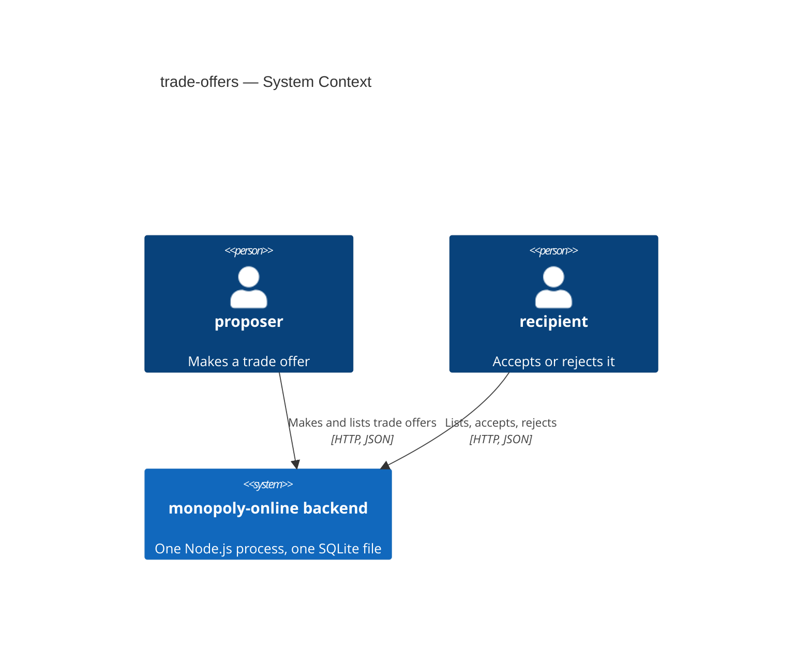
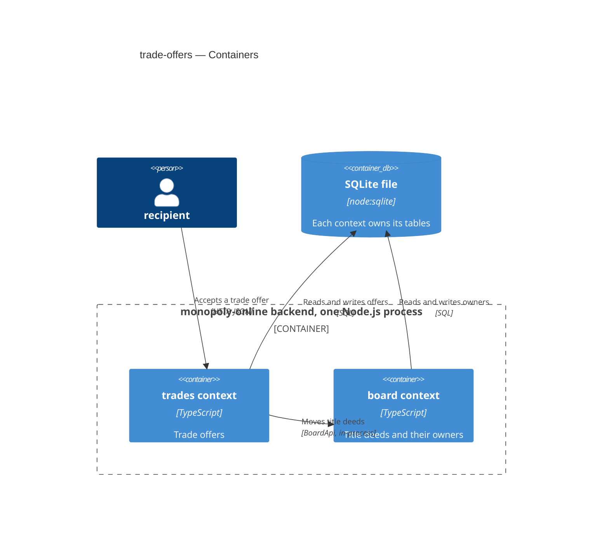
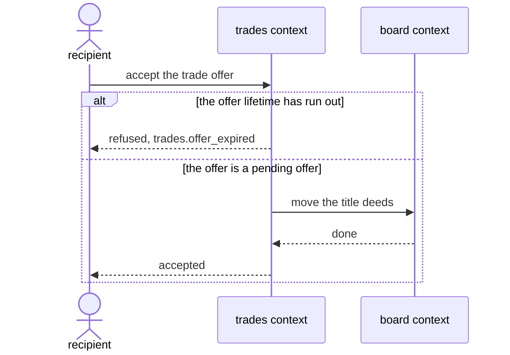

# Mermaid for game-sad

Three kinds of block: `C4Context` in §3, `C4Container` in §5, `sequenceDiagram` in §6. L3 and L4 are not
drawn: for one context the slice tree in §5 says more than a component diagram, and the code says the rest.

## §3 context

The backend is one box. Actors are glossary roles. Trust ends at the HTTP interface.



No external systems is a valid diagram. Say it under the block as a decision.

## §5 containers

Each context is a container inside one boundary, because they share a process and are deployed together.
The SQLite file sits outside the boundary. Calls between contexts are labelled with the api and
"in-process".



## §6 sequences

Participants are §5 containers, aliased to short ids. A refusing branch ends with its code.



## Check before commit

`mmdc` is not installed in this repo, so check by hand and say so in the handoff:

- every block opens with ```` ```mermaid ```` and its type on the next line, and closes with ```` ``` ````
- `Container_Boundary` spelled exactly so, with `{` on its line and a closing `}`
- every id in a `Rel` is declared above it; ids are plain words, no dots or dashes
- labels in double quotes, no double quote inside a label
- every `alt` has its `end`; `else` only inside an `alt`
- no `+` or `-` activation marks: they break when an `alt` branch returns early

If `npx` may download packages, run
`npx -y @mermaid-js/mermaid-cli -i docs/features/<slug>/game-sad.md -o /tmp/check.md` instead.
