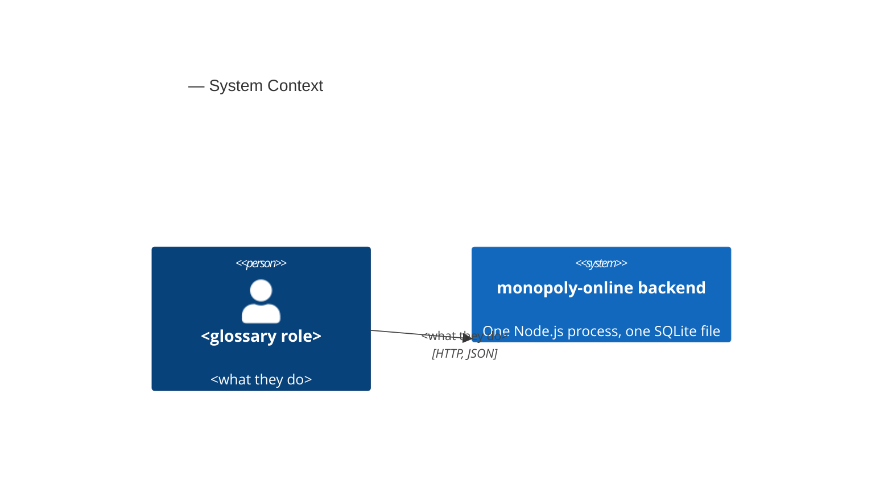
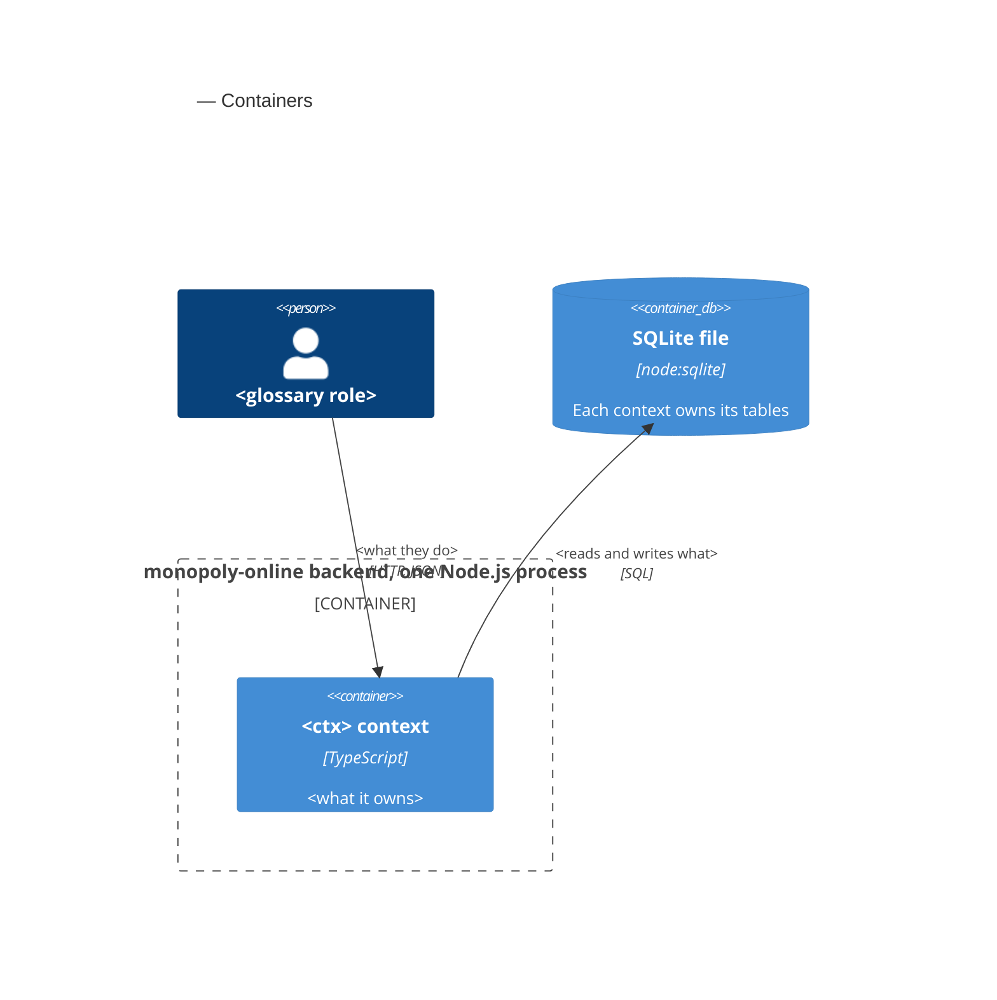

# SAD: <feature name>

> Inputs: [PRD](./<PRD file>) · [CONTEXT](./CONTEXT.md) · [ARCHITECTURE.md](../../../ARCHITECTURE.md) ·
> ADRs in [game-adr/](./game-adr/)

## 1. Introduction and goals

<!-- One paragraph: what players can do after this feature, from PRD §1-§2. Then three quality goals as
QG-1..QG-3, each one line, each backed by a PRD §6 row. Money and title deed integrity come first whenever the
feature moves them. Stakeholders are the glossary roles plus the game owner. -->

**Quality goals**

1. QG-1 <one line>
2. QG-2 <one line>
3. QG-3 <one line>

**Stakeholders**

| Role | Interest |
|---|---|
| <glossary role> | <what they do in this feature> |
| game owner | approves this document and the ADRs |

Decisions kept against the critic:

<!-- One line per finding the owner kept, with their reason. Delete the heading if none. -->

## 2. Constraints

<!-- Versions exactly as package.json and .nvmrc state them. Repo rules from CLAUDE.md and ARCHITECTURE.md
that this feature must keep, one line each. Then what the PRD fixes (prerequisite features, no deadline, and
so on). -->

**Stack**: Node <.nvmrc>, TypeScript <version>, Fastify <version>, `node:sqlite`, vitest <version>, pnpm
<version>.

**Repo rules**

- <one feature touches one context; others through `<Ctx>Api` from `module.ts`>
- <migrations `NNNN_<ctx>_<name>.sql`, frozen once applied>
- <`pnpm check` green before every commit>

**From the PRD**

- <prerequisites, order, what is out of scope>

## 3. Context and scope

<!-- Two or three sentences on who talks to the backend and where trust ends (the HTTP interface: neither
the body nor "I am player X" is trusted without a check). Actors are glossary roles only. External systems:
none today; if none, say so as a decision. -->

**External systems**: <none, as a decision of this version | name and why>



## 4. Solution strategy

<!-- 2-4 choices, each a heading line plus 2-3 sentences of why, tied to a QG or a §2 constraint. The first
is always "which context owns the feature's data". Mark each one with its ADR or "inline". -->

**Surface**: backend-service.

1. **<choice>** (<ADR-NNNN | inline>): <why>.
2. **<choice>** (<ADR-NNNN | inline>): <why>.

## 5. Building block view

<!-- The slice anatomy from ARCHITECTURE.md filled for this feature, then the context map delta, then the
api table, then the container diagram. Names from the "Containers this repo already has" table in SKILL.md. -->

**Slice**

```
src/<ctx>/
├── domain/<entity>.ts
├── app/service.ts
├── infra/sqlite/<entity>Repo.ts
├── infra/http/routes.ts
└── module.ts
migrations/<next free NNNN>_<ctx>_<name>.sql
test/<ctx>/<entity>.test.ts
```

**Context map delta**

| Context | Owns | Uses before | Uses after |
|---|---|---|---|
| <ctx> | <tables> | <...> | <...> |

Creation order in `src/app.ts` after this feature: <lobby, board, bank, turns, ...>.

**Api calls across a boundary**

| From | To | Call | Reads or writes | PRD AC |
|---|---|---|---|---|
| <ctx> | <ctx> | <what it asks, in words> | <read | write> | <AC ids> |



## 6. Runtime view

<!-- One sequenceDiagram per PRD §9 transition (or, without §9, per state change the AC describe) that
crosses a context boundary; at most two here for S, the
rest go to complete-sequence-diagrams. Participants are §5 containers. Messages are semantic ("move the
title deeds"), no HTTP verbs, paths or status numbers. Each refusing alt branch ends with its §10.2 code, or with
its kind from src/shared/errors.ts when the PRD has no §10.2. -->

**Flow 1: <transition from PRD §9>** (<AC ids>)

```mermaid
sequenceDiagram
    actor <role>
    participant <ctx> as <ctx> context
    participant sqlite as SQLite file
    <role>->><ctx>: <what they ask>
    alt <refusal condition>
        <ctx>-->><role>: refused, <ctx>.<error_name>
    else <happy condition>
        <ctx>->>sqlite: <write>
        <ctx>-->><role>: <result>
    end
```

## 7. Deployment view

<!-- Default: one process, one SQLite file, nothing changes. Then write the N/A marker and one line. Fill it
only when the feature adds a process, a port, an env variable or a scheduled job. -->

<!-- N/A: <reason> -->

## 8. Crosscutting concepts

<!-- One row per concept that more than one context or every route of the feature relies on. Rows that only
restate CLAUDE.md say "kept" and link it. -->

| Concept | Rule in this feature | Where |
|---|---|---|
| Refusals | <kinds from errors.ts; codes `<ctx>.<error_name>` from PRD §10.2, none invented when it is absent> | <PRD §10.2, src/shared/errors.ts> |
| Acting player | <how a request says who acts> | <ADR or §4> |
| Transactions | <what runs in one transaction; no await inside> | <ADR or src/shared/db.ts> |
| Time | <where the clock comes from, how tests set it> | <...> |
| Logging | <what the feature logs, if anything> | <...> |

## 9. Architecture decisions

| ADR | Decision | Gate | Status | Section |
|---|---|---|---|---|
| [NNNN](./game-adr/NNNN-<ctx>-<decision>.md) | <imperative> | <n of 4> | Accepted | §<N> |

Decided inline, below the gate:

- <decision> (§<N>): <criteria that fired, n of 4>

## 10. Quality requirements

<!-- One scenario per QG plus one per remaining PRD §6 row. Numbers copied from PRD §6 character for
character. How verify names the test file and the helper. -->

**QG-1. <name>**

- When: <trigger>
- Then: <PRD §6 target, verbatim>
- How verify: <test/<ctx>/<file>.test.ts through makeTestApp(), what is asserted>

## 11. Risks and technical debt

<!-- Product risk first when a PRD §7 KPI has a trigger. Severity Low / Medium / High, or Open question with
owner and due. -->

| Risk | Severity | Mitigation | Owner | Due |
|---|---|---|---|---|
| <risk> | <Low/Medium/High/Open question> | <what is done> | <who> | <when, for open questions> |

**Accepted debt**

- <what is left on purpose and when it is looked at again>

## 12. Glossary

<!-- Terms from CONTEXT.md this document uses, in its words. A new term goes here marked "not in CONTEXT"
and to the handoff for /sdlc:fix-term. -->

| Term | Meaning |
|---|---|
| <term> | <from CONTEXT.md> |
