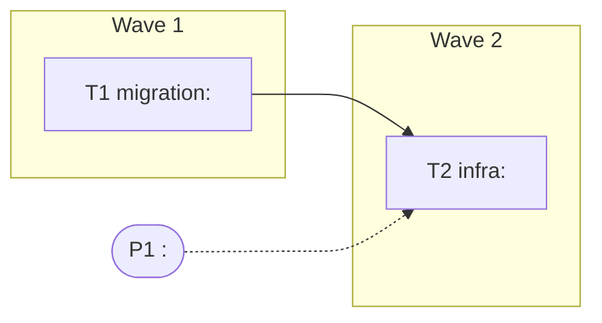

# Epic — <slug>

> [game-prd](../game-prd.md) · [game-sad](../game-sad.md) · [game-data-model](../game-data-model.md) ·
> [game-contracts](../game-contracts/openapi.yaml) · [game-adr](../game-adr/) · [CONTEXT](../CONTEXT.md)

## Goal

<Two or three sentences from game-prd §2: what a player can do once every task is done.>

## Prerequisites

| # | Context | What this feature needs from it | Blocks |
|---|---|---|---|
| P1 | <ctx> | <the api call the design makes, missing from src/<ctx>/module.ts> | <task ids> |

## Waves

## Tasks

See [tracker.md](./tracker.md) for status and [tasks.json](./tasks.json) for the machine form.

| # | Task | Layer | Wave | Deps | Needs | ACs | Codes |
|---|---|---|---|---|---|---|---|
| T1 | [<title>](./<task-slug>.md) | migration | 1 | — | — | AC-NN | — |

## Hard rules

<Only the rules of game-sad §11 and the accepted ADRs a task could break, one line each.>
