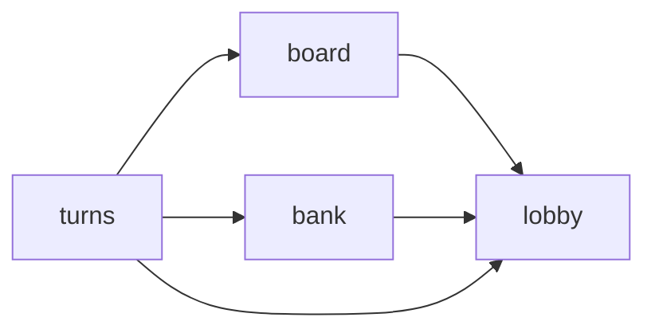

# Architecture

Hexagonal per bounded context. Each context owns its tables, its use cases and its routes, and shows other
contexts one typed `api`.

## Context map

| Context | Owns                                   | Uses                  |
| ------- | -------------------------------------- | --------------------- |
| `lobby` | players, rooms                         | nothing               |
| `board` | tiles, title deeds (properties)        | `lobby`               |
| `bank`  | player accounts, transfers             | `lobby`               |
| `turns` | dice rolls, moves                      | `lobby`, `board`, `bank` |



Arrows point from the context that calls to the one it calls. So far only `board` → `lobby` is wired. The others
are still planned. A context starts taking another's `api` with the first feature that needs it. `src/app.ts` creates the modules in this
order (lobby, board, bank, turns), so a context can only take the api of one created before it, and the
graph stays acyclic.

## Dependency rule

Inside a context, imports point inward.

```
infra/http, infra/sqlite  ->  app  ->  domain  ->  shared/errors
module.ts                 ->  everything in its own context
```

- `domain/` imports nothing but `shared/errors`.
- `app/` imports its own `domain/` (and `shared/`), never `infra/`.
- `infra/` implements what `domain/` declares.
- `shared/` imports no context.

`pnpm arch:check` checks part of this with the dependency-cruiser rules `domain-no-infra`, `domain-no-app`,
`app-no-infra`, `shared-no-contexts`, `no-circular`, and the public api rule below. Type-only imports count.
Two parts are conventions only, kept by review. `domain/` stays free of `fastify`, `node:sqlite` and the
rest of `shared/`, and contexts never import `src/app.ts` or `src/index.ts`.

## Public api rule

A context may import another context only through `src/<other>/module.ts` (`no-cross-context-internals`);
everything else in a context folder is private. By convention it imports only the exported `<Ctx>Api` type
from there; a value import such as `createBoardModule` is not flagged, so don't rely on the check for it.

The api object itself is handed over in `src/app.ts`, the composition root.

```ts
const lobby = createLobbyModule({ db });
const board = createBoardModule({ db, lobby: lobby.api });
```

`src/app.ts` and `src/index.ts` are the wiring layer. Only `src/app.ts` imports more than one context.

## Slice anatomy

A feature in context `<ctx>` adds these files.

```
src/<ctx>/
  domain/<entity>.ts        types, validation (throws shared/errors), repository interface
  app/service.ts            use cases; takes the repository and other contexts' apis as arguments
  infra/sqlite/<entity>Repo.ts   repository on node:sqlite, prepared statements
  infra/http/routes.ts      Fastify routes with JSON schemas for params, body and response
  module.ts                 builds repo -> service -> routes; exports <Ctx>Api
migrations/NNNN_<ctx>_<name>.sql   forward-only, applied once each by src/shared/migrate.ts
test/<ctx>/<entity>.test.ts        HTTP-level tests through makeTestApp()
```

Domain and app throw `notFound`, `conflict` or `invalid` from `shared/errors`; `shared/http.ts`
turns them into `{ error: { code, message } }` with the matching status. Schema validation failures become
400 `invalid`; Fastify's own client errors (malformed JSON, wrong content type, body too large) keep their
4xx with code `bad_request`; an unknown route is 404 `not_found`; anything unexpected becomes 500 `internal`
with no details. A SQLite constraint error is unexpected too, so a duplicate check belongs in the service.
The service looks up first, throws `conflict`, then inserts. `node:sqlite` is synchronous, so with no `await` between the
lookup and the insert nothing can race.
