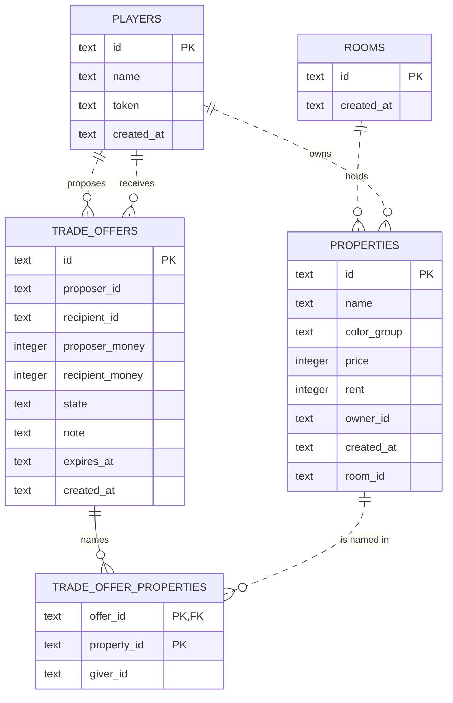

# Data model — trade-offers

Brownfield delta on the schema of `migrations/0001`–`0003`. The migrations are staged under
[`migrations/`](./migrations/), not in the live `migrations/` tree; `implement-tasks` promotes them.
The `rooms` and `properties.room_id` pairs belong to the `lobby` and `board` prerequisite features and are
promoted by them (CLAUDE.md: one feature touches one context); trade-offers promotes only the two `trades`
pairs.

Inputs: [PRD.md](./PRD.md) §1, §5; [sad.md](./sad.md) §4, §5, §6, §8; ADR-0001, ADR-0002.

Three things change:

1. `trades` gets two new tables, `trade_offers` and `trade_offer_properties`.
2. **Breaking change in `board`:** a title deed belongs to one room, so `properties.room_id` is added and
   becomes `NOT NULL` (PRD §1, prerequisite "title deeds that belong to one room"). Title deeds that exist
   already move to one bootstrap room.
3. `lobby` gets a minimal `rooms` table that holds the bootstrap room.

The database is SQLite (`node:sqlite`), so ids and timestamps are `TEXT` and money is `INTEGER` (sad.md §2,
§8). A context holds no foreign key into another context's table: a reference across contexts is a plain id
column, checked through the other context's api, as `properties.owner_id` is today.

## ER diagram

Solid lines are foreign keys. Dotted lines are ids of another context, with no constraint in the database.

## Entities

### `trade_offers` (new, `trades`)

| Column | Type | Constraints | Notes |
|---|---|---|---|
| `id` | TEXT | PK | `randomUUID()` in the service (sad.md §8) |
| `proposer_id` | TEXT | NOT NULL | a `lobby` player; always the acting player (AC-06b) |
| `recipient_id` | TEXT | NOT NULL | a `lobby` player of the same room (AC-05) |
| `proposer_money` | INTEGER | NOT NULL | whole coins the proposer gives; `0` when none, written by the service |
| `recipient_money` | INTEGER | NOT NULL | whole coins the recipient gives; `0` when none |
| `state` | TEXT | NOT NULL | `pending`, `accepted` or `rejected`; the set lives in `trades/domain` |
| `note` | TEXT | NULL | the proposer's note to the recipient, at most 140 characters, checked in `trades/domain`; `NULL` when none |
| `expires_at` | TEXT | NOT NULL | ISO 8601 UTC, `created_at` plus the offer lifetime; from the app clock |
| `created_at` | TEXT | NOT NULL | ISO 8601 UTC, from the app clock |

**Aggregate root:** root.
**Access patterns:** the pending offer of a proposer and the offers a proposer made → `trade_offers_proposer_id`;
the pending offers addressed to a recipient → `trade_offers_recipient_pending`.
**Constraints:** none beyond NOT NULL.

- An expired offer is not a stored state. It is a `pending` row whose `expires_at` is not later than the clock
  (sad.md §4, choice 4). Timestamps are compared as text; that is correct while every value has the format of
  `Date.toISOString()`.
- `state` is the only column that changes after the insert, and it changes once. There is no `updated_at`: the
  PRD asks for no answer time.
- One pending offer per proposer (AC-04) is checked in the service. A unique index cannot express it, because
  "pending" depends on the clock.
- The row stores no room. Room membership is read from `lobby` when an offer is made and again when it is
  accepted (sad.md §5).

### `trade_offer_properties` (new, `trades`)

| Column | Type | Constraints | Notes |
|---|---|---|---|
| `offer_id` | TEXT | NOT NULL, PK part 1, FK → `trade_offers(id)` | |
| `property_id` | TEXT | NOT NULL, PK part 2 | a `board` title deed |
| `giver_id` | TEXT | NOT NULL | the side that gives the deed: the offer's proposer or its recipient |

**Aggregate root:** `trade_offers`. Rows are written with the offer and never change.
**Access patterns:** the title deeds of one offer → the primary key, which starts with `offer_id`.
**Constraints:** PK (`offer_id`, `property_id`): a title deed is named once per offer (AC-02).

No `created_at`: the row is created with its offer and carries the same time.

### `properties` (changed, `board`) — breaking

| Column | Type | Constraints | Notes |
|---|---|---|---|
| `room_id` | TEXT | NOT NULL | new. The room the title deed belongs to; a `lobby` room |

The other columns, the three `CHECK` constraints and the index `properties_name_nocase` stay as in
`migrations/0003_board_properties.sql`.

The change is split into three steps, each its own migration:

| Step | Staged file | What it does | Ships with |
|---|---|---|---|
| 1. expand | `20261117083002_add_room_id_to_properties` | adds `room_id`, nullable | the code that writes `room_id` on every insert |
| 2. backfill | `20261117083003_backfill_properties_room_id` | moves every title deed without a room to the bootstrap room | any time after step 1; see [backfill-room_id.md](./migrations/backfill-room_id.md) |
| 3. contract | `20261117083004_set_properties_room_id_not_null` | rebuilds the table with `room_id NOT NULL` | only after no insert path leaves `room_id` empty |

SQLite cannot add `NOT NULL` to an existing column, so step 3 creates a new table, copies the rows, drops the
old table and renames the new one. After step 3 an insert without `room_id` fails. Today
`src/board/infra/sqlite/propertyRepo.ts` writes no `room_id`, so step 3 must not be promoted before that code
changes.

<!-- TBD: properties_name_nocase makes a title deed name unique across all rooms. With title deeds per room
a second room cannot have its own "Boardwalk". Decide in the board prerequisite whether the name becomes
unique per room. -->

### `rooms` (new, `lobby`) — minimal

| Column | Type | Constraints | Notes |
|---|---|---|---|
| `id` | TEXT | PK | |
| `created_at` | TEXT | NOT NULL | ISO 8601 UTC |

Only what the bootstrap room needs. The `lobby` rooms prerequisite owns this table and adds members and any
other column with its own migrations.

<!-- TBD: who the players of the bootstrap room are. Existing players are in no room, so a title deed in the
bootstrap room may have an owner who is not a member of it. Decide in the lobby rooms prerequisite. -->

**Seed (bootstrap):** one room with the fixed id `00000000-0000-7000-8000-000000000001`, inserted with
`ON CONFLICT DO NOTHING`.

## Indexes

| Index | Columns | Query it serves |
|---|---|---|
| `trade_offers_proposer_id` | `proposer_id` | "load the unanswered offer of the proposer whose lifetime has not run out" (Propose, AC-04); "read every offer made by the acting player" (List the offers I made, AC-15) |
| `trade_offers_recipient_pending` | `recipient_id`, `state`, `expires_at` | "read the unanswered offers addressed to the acting player whose lifetime has not run out" (List pending offers addressed to me, AC-13) |
| primary key of `trade_offer_properties` | `offer_id`, `property_id` | the title deeds of one offer, in every flow that shows or carries out an offer; also the index on the foreign key |

No index on `properties.room_id`: every flow reads a title deed by id and takes its room from the row. No
index on `property_id` or `giver_id`: no flow looks an offer up by title deed.

## Test fixtures

None. Tests go through HTTP with `makeTestApp()`, which applies every migration to a fresh in-memory
database, so a test creates players, title deeds and offers through the routes. No seed holds a name, an
email or any other personal data.
