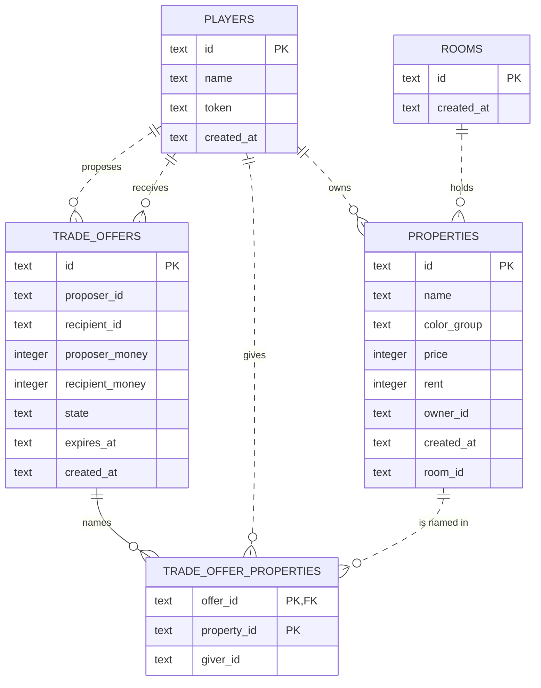

# Data model — trade-offers

`trades`, a new context (ADR-0001), gets two tables: `trade_offers` and `trade_offer_properties`. `board`
gets a breaking change: a title deed belongs to one room, so `properties.room_id` is added and becomes
`NOT NULL` in three steps. `lobby` gets a minimal `rooms` table with one bootstrap room for the title deeds
that exist already.

The owner chose `PRD.md` and `sad.md` as the sources; `game-prd.md` and `game-sad.md` were not read.

Live schema before this feature: `migrations/0001`–`0003` (from `scripts/schema.ts`).

## ER diagram

Solid lines are foreign keys inside one context. Dotted lines are ids from another context.

## Tables

Aggregates: `trade_offers` is a root; the rows of `trade_offer_properties` are written with their offer and
die with it. `rooms` and `properties` are roots of their own contexts.

### `trade_offers` — `trades`, new

| Column | Type | Null | Source | Note |
|---|---|---|---|---|
| `id` | `TEXT` | no | convention | `randomUUID()` in the service; random, so it cannot be guessed (ADR-0003) |
| `proposer_id` | `TEXT` | no | AC-01, AC-06b | a `lobby` player, always the acting player; plain id |
| `recipient_id` | `TEXT` | no | AC-01, AC-05 | a `lobby` player of the same room; plain id |
| `proposer_money` | `INTEGER` | no | AC-01, AC-02, sad.md §8 Money | whole coins the proposer gives; the service writes `0` when none |
| `recipient_money` | `INTEGER` | no | AC-01, AC-02, sad.md §8 Money | whole coins the recipient gives; the service writes `0` when none |
| `state` | `TEXT` | no | sad.md §5 | `pending`, `accepted` or `rejected`; the set lives in `trades/domain` |
| `expires_at` | `TEXT` | no | sad.md §4 choice 4, AC-11 | `created_at` plus the offer lifetime, from the app clock |
| `created_at` | `TEXT` | no | convention | app clock |

- An expired offer is derived, not stored: a `pending` row whose `expires_at` is not later than the clock
  (sad.md §4, choice 4). Timestamps are compared as text, which is correct while every value has the format of
  `Date.toISOString()`.
- No `updated_at` and no answer time (owner's decision): `state` changes once, the PRD asks for no answer
  time, and the Answered offers KPI is counted from `state`.
- One pending offer per proposer (AC-04) is checked in the service. A unique index cannot express it, because
  "pending" depends on the clock.
- No room column: room membership is read from `lobby` when an offer is made and again when it is accepted
  (sad.md §5).

### `trade_offer_properties` — `trades`, new

| Column | Type | Null | Source | Note |
|---|---|---|---|---|
| `offer_id` | `TEXT` | no | AC-01 | PK part 1; FK → `trade_offers(id)` |
| `property_id` | `TEXT` | no | AC-01, AC-02 | PK part 2; a `board` title deed; plain id |
| `giver_id` | `TEXT` | no | AC-06, AC-16; owner's decision | the side that gives the title deed: the offer's proposer or its recipient, checked in `trades/domain` |

- The primary key `(offer_id, property_id)` stores a title deed once per offer (AC-02 refuses a title deed
  named twice in the service first).
- No `id` and no `created_at`: a row is part of its offer and is never read or changed by itself.
- The foreign key has no `ON DELETE`. No flow deletes an offer; a future one deletes the child rows first.

### `rooms` — `lobby`, new, minimal

| Column | Type | Null | Source | Note |
|---|---|---|---|---|
| `id` | `TEXT` | no | PRD §1 prerequisites | fixed literal for the bootstrap room |
| `created_at` | `TEXT` | no | convention | fixed literal for the bootstrap room |

Only what the bootstrap room needs. The `lobby` rooms feature owns the rest: members, a name and anything
else, with its own migrations.

### `properties` — `board`, changed

| Column | Type | Null | Source | Note |
|---|---|---|---|---|
| `room_id` | `TEXT` | no (after `0008`) | PRD §1 prerequisites, sad.md §5 (`board`: a title deed's room) | a `lobby` room; plain id |

Every other column, the three `CHECK`s and the index `properties_name_nocase` stay as in
`migrations/0003_board_properties.sql`.

### Not staged here

These prerequisites of PRD §1 get no table in this feature (owner's decision); `trades` reaches them through
the apis listed in sad.md §5.

| Entity | Owner |
|---|---|
| players of a room (membership) | the `lobby` rooms feature |
| money account, balance | the `bank` accounts feature |
| player secret (hash) | the `lobby` player secret feature (ADR-0003) |

## Indexes

| Index | Columns | Read it serves (sad.md §6) |
|---|---|---|
| primary key of `trade_offers` | `(id)` | Accept, Reject: "load the offer" |
| `trade_offers_proposer_id` | `(proposer_id)` | Propose: "load the unanswered offer of the proposer whose lifetime has not run out" (AC-04); List the offers I made: "read every offer made by the acting player" (AC-15) |
| `trade_offers_recipient_pending` | `(recipient_id, expires_at) WHERE state = 'pending'` | List pending offers addressed to me: "read the unanswered offers addressed to the acting player whose lifetime has not run out" (AC-13) |
| primary key of `trade_offer_properties` | `(offer_id, property_id)` | every flow that shows or carries out an offer: the title deeds of one offer; also the index on the foreign key |

Two indexes on `trade_offers`, not three (owner's decision): a proposer has few offers, so
`trade_offers_proposer_id` serves both reads by proposer. Query plans on the rehearsal file use each index
for its read. No index on `properties.room_id`, `property_id` or `giver_id`: no flow in §6 reads by them.

## Migrations

Promote in this order; a step waits for the code named next to it. Each file keeps its staged name. The
`.down.sql` files stay here.

| Staged file | Context | Step | Ships with |
|---|---|---|---|
| `0004_lobby_rooms.sql` | `lobby` | create | nothing; before `0005` |
| `0005_lobby_bootstrap_room.sql` | `lobby` | seed | nothing; before `0007` |
| `0006_board_properties_room_id.sql` | `board` | expand | the `board` commit in which every insert of a title deed writes `room_id` |
| `0007_board_properties_room_id_backfill.sql` | `board` | backfill | nothing; see [backfill-room_id.md](./game-migrations/backfill-room_id.md) |
| `0008_board_properties_room_id_not_null.sql` | `board` | contract | waits for the commit of `0006` to be in and for no other insert path to be left; ships with the `board` commit that makes `roomId` required in the domain type |
| `0009_trades_offers.sql` | `trades` | create | the first `trades` commit (propose a trade offer) |
| `0010_trades_offer_properties.sql` | `trades` | create | the same commit as `0009` |

If another feature takes a number first, renumber the staged files that are not promoted yet; the order
stays.

## Breaking change

`properties.room_id`: expand in `0006`, backfill in `0007` (see `game-migrations/backfill-room_id.md`),
contract in `0008`. Three steps, three commits, confirmed by the owner.

Between expand and contract the code writes `room_id` on every insert and reads it as possibly empty. After
the contract an insert without `room_id` fails. Today `src/board/infra/sqlite/propertyRepo.ts` writes no
`room_id`, so `0008` must not be promoted before that changes.

The contract step does not sweep a row whose `room_id` is still NULL (owner's decision): the copy fails, the
migration fails and the app does not start. That shows that code which does not write `room_id` is still
running. Recovery is in `backfill-room_id.md`.

<!-- TBD: properties_name_nocase keeps a title deed name unique across all rooms, so a second room cannot
have its own "Boardwalk". Whether the name becomes unique per room is for the board per-room title deeds
feature. -->

## Seeds

One bootstrap row in `0005_lobby_bootstrap_room.sql`: room `00000000-0000-7000-8000-000000000001`,
`created_at` `2026-11-17T00:00:00.000Z`, `ON CONFLICT DO NOTHING`. No lookup rows. No test data: tests build
players, title deeds and offers through HTTP with `makeTestApp()`.

<!-- TBD: who the players of the bootstrap room are. Existing players are in no room, so a title deed in the
bootstrap room may have an owner who is not a member of it. For the lobby rooms feature. -->

## Drift

Domain types and repos against the live schema (`0001`–`0003`):

| Finding | Where | Proposed fix |
|---|---|---|
| `nullability-mismatch` | `players.id` is `TEXT PRIMARY KEY` without `NOT NULL`, so SQLite accepts NULL; `Player.id` is `string` | `game-migrations/_drift/0011_lobby_players_id_not_null` (table rebuild) |
| `nullability-mismatch` | `properties.id`, the same; `Property.id` is `string` | `game-migrations/_drift/0012_board_properties_id_not_null` (table rebuild, written against the schema after `0008`) |

Both are harmless today: the services always write `randomUUID()`. The pairs are proposals for `lobby` and
`board`, not part of this feature, and are not in the promote order above. No `field-without-column`,
`column-without-field` or `type-mismatch` in `players` or `properties`.

`properties.room_id` has no field in `Property` yet. That is the expand step of this feature, not drift.
`trades` has no code yet, so its tables have nothing to drift from.

Model against spec: the one entity of this feature, trade offer (PRD §4, §5), has `trade_offers` and
`trade_offer_properties`. Of the prerequisites of PRD §1, room has `rooms` and per-room title deeds have
`properties.room_id`; money accounts and the player secret have no table here, see "Not staged here". Every
table has an origin: `trade_offers` and `trade_offer_properties` in sad.md §5 and §6, `rooms` and
`properties.room_id` in PRD §1.

## Check

| Check | Result |
|---|---|
| Names | pass: plural snake_case tables; the 7 up files match the runner's pattern `NNNN_<context>_<name>.sql`, the downs are `.down.sql` |
| Down reverses up | pass: each down undoes its own up only; confirmed by the rehearsal |
| FK columns indexed | pass: the one foreign key, `trade_offer_properties.offer_id`, leads the primary key |
| No new CHECK / TRIGGER / business DEFAULT | pass: 3 `CHECK` hits, all in `0008`, copied verbatim from `migrations/0003_board_properties.sql`; no `TRIGGER`, no `DEFAULT` |
| Rehearsal up → down → up | pass: `after down vs before up: same`, `after second up vs first up: same` (7 pairs on a scratch file outside the repo; the same result with the two `_drift` pairs added) |

The rehearsal script looked for `*.up.sql` and so ran no pair on the names this skill stages; it was fixed
in the same change to read `NNNN_<context>_<name>.sql` and to fail on an empty folder.

Open:

- TBD, "Breaking change": title deed name unique across rooms or per room. For the `board` per-room title
  deeds feature.
- TBD, "Seeds": the players of the bootstrap room. For the `lobby` rooms feature.
- The two drift proposals wait for a decision by the owner.
- `docs/features/trade-offers/data-model.md` and `migrations/` there are the earlier model from the SDLC
  flow, with timestamp file names and a contract step that sweeps NULL rows. They disagree with this
  document on both points and are left untouched.
