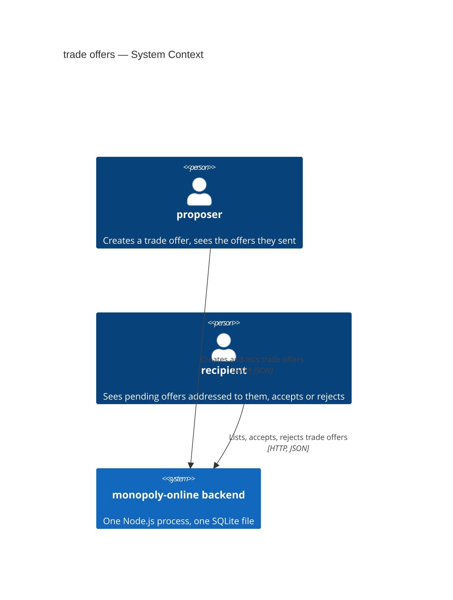
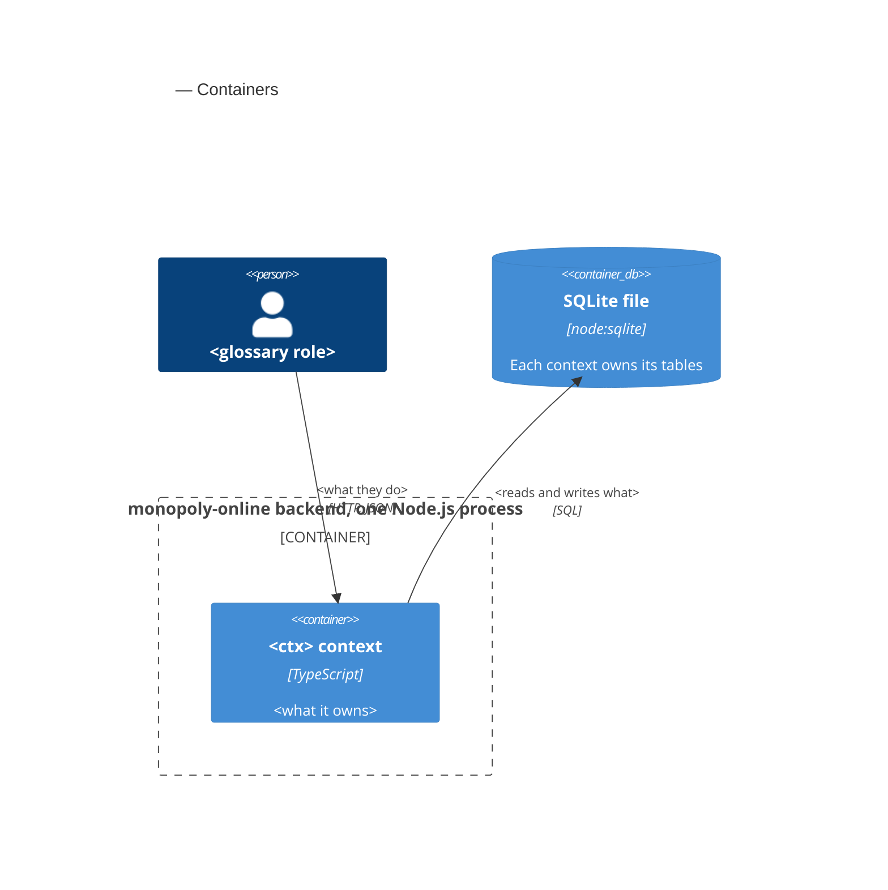

# SAD: trade offers

> Inputs: [PRD](./game-prd.md) · [CONTEXT](./CONTEXT.md) · [ARCHITECTURE.md](../../../ARCHITECTURE.md) ·
> ADRs in [game-adr/](./game-adr/)

## 1. Introduction and goals

After this feature a proposer can offer one recipient in the same room some of their title deeds and/or money
for some of the recipient's. The recipient accepts or rejects the trade offer as a whole, or it becomes an
expired offer after its offer lifetime of 5 minutes. On acceptance ownership, balances and room membership are
checked again, and everything named changes hands at once or nothing does. Without trading a color group ends
up in one hand only by luck and the first full games stall ([PRD](./game-prd.md) §1, §2).

**Quality goals**

1. QG-1 Integrity: an exchange happens in full or not at all; money in a room is unchanged by any exchange and
   every title deed has exactly one owner after every action (PRD §6 rows 3, 4).
2. QG-2 One winner: when two players act on the same thing at once, exactly one wins, 100 of 100 runs (PRD §6
   row 5).
3. QG-3 Speed: p95 of one write action (propose, accept, reject) ≤ 5 ms; p95 of one list action, 300 rows
   ≤ 10 ms (PRD §6 rows 1, 2).

**Stakeholders**

| Role | Interest |
|---|---|
| proposer | creates a trade offer, sees every offer they sent with its state |
| recipient | sees pending offers addressed to them, accepts or rejects each as a whole |
| game owner | approves this document and the ADRs |

## 2. Constraints

**Stack**: Node 24, TypeScript 6.0.3, Fastify 5.12.7, `node:sqlite`, vitest 5.0.5, pnpm 11.0.9.

**Repo rules**

- one feature touches one context; another context is reached through its `<Ctx>Api` from `module.ts`, handed
  over in `src/app.ts`
- a context takes only the api of a context created before it in `src/app.ts`; the graph stays acyclic
- imports point inward: `infra` → `app` → `domain` → `shared/errors`; no context reads another's tables
- schema changes are new files `migrations/NNNN_<ctx>_<name>.sql`, next free number is 0004; applied migrations
  are frozen
- refusals leave domain and app code as `notFound` / `conflict` / `invalid` from `src/shared/errors.ts`; a
  SQLite constraint error is a 500, so every check is made in the service before the write
- every route declares a JSON schema for params, body and response
- tests go through HTTP with `makeTestApp()`
- `node:sqlite` is synchronous: with no `await` between a read and a write nothing can race
- `pnpm check` is green before every commit

**From the PRD**

- three prerequisites are separate features, in this order: rooms and their members (`lobby`), money accounts
  with a move of money between two players (`bank`), title deeds that belong to a room with an owner change for
  several deeds at once (`board`). None exists in the code today: `lobby` has players only, `BankApi` and
  `BoardApi` are empty. This document names what trade offers need from each; it does not design them
- the game must know which player is acting (PRD §11); AC-15 and AC-16 cannot be tested without it
- nothing from `turns`
- no outside deadline; the order of upcoming work sets the urgency
- out of scope, PRD §3: counter-offers, withdrawal, closing an offer that can no longer be honoured, any signal
  that an offer arrived, several recipients, partial acceptance

## 3. Context and scope

A proposer and a recipient reach the backend over HTTP with JSON; nothing else talks to it. Trust ends at the
HTTP interface: neither the body nor "I am player X" is believed without a check, and what a player may see is
decided inside the backend (PRD §8, AC-15, AC-16). The same player is a proposer in one trade offer and a
recipient in another; the diagram shows the two roles, not two kinds of account.

**External systems**: none, as a decision of this version. The expiry of an offer needs no scheduler or queue,
and no signal reaches players (PRD §3).



## 4. Solution strategy

**Surface**: backend-service.

1. **A new `trades` context owns trade offers**
   ([ADR-0001](./game-adr/0001-trades-own-trade-offers-in-a-new-context.md)): a trade offer is neither a title
   deed nor an account, and one acceptance changes both. `trades` takes `LobbyApi`, `BoardApi` and `BankApi` and
   is created last in `src/app.ts` (lobby, board, bank, turns, trades), so the graph stays acyclic and `board`
   and `bank` stay unaware of each other (§2). It answers PRD §11, first question. Considered: offers inside
   `board` (needs a new arrow board → bank and `bank` created before `board`); offers inside `bank` (bank →
   board, and a money context would own deeds in offers).
2. **One acceptance runs in one SQLite transaction, and `board` and `bank` guard their own writes**
   ([ADR-0002](./game-adr/0002-shared-run-exchange-in-one-transaction.md)): `trades` opens a transaction, asks
   `board` to move the deeds and `bank` to move the money, marks the offer accepted, and commits; nothing inside
   awaits. `board` refuses to move a deed whose owner is not the giving side, `bank` refuses to move money a
   side does not hold, and any refusal rolls everything back, so the offer stays pending. This is QG-1 and
   QG-2: a crash between the two writes cannot leave a half-done exchange, and of two acceptances the second
   one sees the first one's result. A small transaction helper is added to `src/shared/db.ts`. Considered:
   check everything first, then write without a transaction (no race thanks to synchronous SQLite, but a crash
   or an unexpected error between the writes leaves half an exchange); undo steps on failure (more code, the
   same crash window).
3. **The acting player is resolved by `lobby` from a secret it issued to that player**
   ([ADR-0003](./game-adr/0003-lobby-resolve-the-acting-player-from-a-lobby-issued-secret.md)): every request
   carries the secret, `trades` asks `LobbyApi` who is acting and never takes a player id for the actor from
   the body. The secret itself (issue, storage, lookup) is a fourth prerequisite feature in `lobby`; this
   document fixes only that it exists and what `trades` asks. It answers PRD §11, second question, and makes
   AC-15 and AC-16 testable. Considered: a player id sent by the client and believed (anyone acts as anyone,
   against §3 and PRD §8); leaving it undecided for the prerequisite feature (AC-15, AC-16 stay untestable and
   §6 has no first step).

## 5. Building block view

<!-- The slice anatomy from ARCHITECTURE.md filled for this feature, then the context map delta, then the
api table, then the container diagram. Names from the "Containers this repo already has" table in SKILL.md. -->

**Slice**

```
src/<ctx>/
├── domain/<entity>.ts
├── app/service.ts
├── infra/sqlite/<entity>Repo.ts
├── infra/http/routes.ts
└── module.ts
migrations/<next free NNNN>_<ctx>_<name>.sql
test/<ctx>/<entity>.test.ts
```

**Context map delta**

| Context | Owns | Uses before | Uses after |
|---|---|---|---|
| <ctx> | <tables> | <...> | <...> |

Creation order in `src/app.ts` after this feature: <lobby, board, bank, turns, ...>.

**Api calls across a boundary**

| From | To | Call | Reads or writes | PRD AC |
|---|---|---|---|---|
| <ctx> | <ctx> | <what it asks, in words> | <read | write> | <AC ids> |



## 6. Runtime view

<!-- One sequenceDiagram per PRD §9 transition that crosses a context boundary; at most two here for S, the
rest go to complete-sequence-diagrams. Participants are §5 containers. Messages are semantic ("move the
title deeds"), no HTTP verbs, paths or status numbers. Each refusing alt branch ends with its §10.2 code. -->

**Flow 1: <transition from PRD §9>** (<AC ids>)

```mermaid
sequenceDiagram
    actor <role>
    participant <ctx> as <ctx> context
    participant sqlite as SQLite file
    <role>->><ctx>: <what they ask>
    alt <refusal condition>
        <ctx>-->><role>: refused, <ctx>.<error_name>
    else <happy condition>
        <ctx>->>sqlite: <write>
        <ctx>-->><role>: <result>
    end
```

## 7. Deployment view

<!-- Default: one process, one SQLite file, nothing changes. Then write the N/A marker and one line. Fill it
only when the feature adds a process, a port, an env variable or a scheduled job. -->

<!-- N/A: <reason> -->

## 8. Crosscutting concepts

<!-- One row per concept that more than one context or every route of the feature relies on. Rows that only
restate CLAUDE.md say "kept" and link it. -->

| Concept | Rule in this feature | Where |
|---|---|---|
| Refusals | <kinds from errors.ts; codes `<ctx>.<error_name>` from PRD §10.2> | <PRD §10.2, src/shared/errors.ts> |
| Acting player | <how a request says who acts> | <ADR or §4> |
| Transactions | <what runs in one transaction; no await inside> | <ADR or src/shared/db.ts> |
| Time | <where the clock comes from, how tests set it> | <...> |
| Logging | <what the feature logs, if anything> | <...> |

## 9. Architecture decisions

| ADR | Decision | Gate | Status | Section |
|---|---|---|---|---|
| [NNNN](./game-adr/NNNN-<ctx>-<decision>.md) | <imperative> | <n of 4> | Accepted | §<N> |

Decided inline, below the gate:

- <decision> (§<N>): <criteria that fired, n of 4>

## 10. Quality requirements

<!-- One scenario per QG plus one per remaining PRD §6 row. Numbers copied from PRD §6 character for
character. How verify names the test file and the helper. -->

**QG-1. <name>**

- When: <trigger>
- Then: <PRD §6 target, verbatim>
- How verify: <test/<ctx>/<file>.test.ts through makeTestApp(), what is asserted>

## 11. Risks and technical debt

<!-- Product risk first when a PRD §7 KPI has a trigger. Severity Low / Medium / High, or Open question with
owner and due. -->

| Risk | Severity | Mitigation | Owner | Due |
|---|---|---|---|---|
| <risk> | <Low/Medium/High/Open question> | <what is done> | <who> | <when, for open questions> |

**Accepted debt**

- <what is left on purpose and when it is looked at again>

## 12. Glossary

<!-- Terms from CONTEXT.md this document uses, in its words. A new term goes here marked "not in CONTEXT"
and to the handoff for /sdlc:fix-term. -->

| Term | Meaning |
|---|---|
| <term> | <from CONTEXT.md> |
