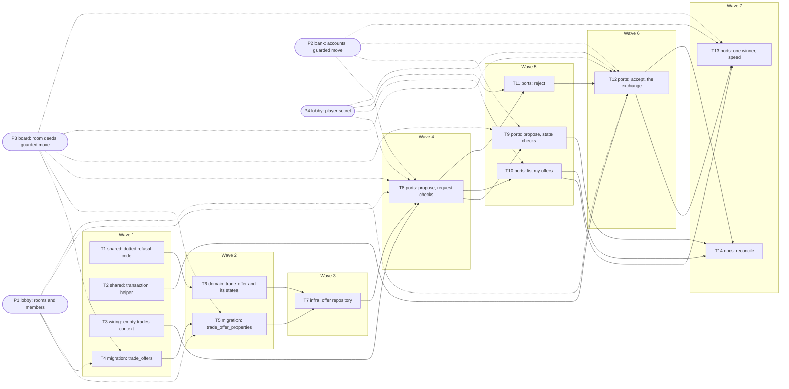

# Epic — trade-offers

> [game-prd](../game-prd.md) · [game-sad](../game-sad.md) · [game-data-model](../game-data-model.md) ·
> [game-contracts](../game-contracts/openapi.yaml) · [game-adr](../game-adr/) · [CONTEXT](../CONTEXT.md)

## Goal

A player who is short of a color group can get the missing title deed by making a deal: a proposer sends one
recipient in the same room a trade offer of title deeds and/or money, and the recipient accepts or rejects it
as a whole, or it expires after 5 minutes. An accepted offer is exchanged in full or not at all. A recipient
sees every offer that needs an answer now, and a proposer knows how each of their offers ended.

## Prerequisites

Each is its own feature in its own context (CLAUDE.md: one feature touches one context). Checked against
`src/*/module.ts` on 2026-11-17: `LobbyApi` has `players.exists` and `players.nameOf` only, `BoardApi` and
`BankApi` are empty. The calls are the rows of the [game-sad §5](../game-sad.md#5-building-block-view) call
table; the build order is that of [game-prd §1](../game-prd.md#1-context).

| # | Context | What this feature needs from it | Blocks |
|---|---|---|---|
| P1 | `lobby` | rooms and their members: "are these two players members of one room"; promotes `0004`–`0005` | T4, T5, T8, T12 |
| P2 | `bank` | money accounts: "how much money this player holds", and a guarded move of money between two players that refuses with `bank.insufficient_funds`, synchronous, with no transaction of its own | T8, T9, T12, T13 |
| P3 | `board` | title deeds that belong to a room: "who owns each of these title deeds, if it exists", and a guarded move of several deeds that refuses with `board.deed_owner_changed`, synchronous, with no transaction of its own; promotes `0006`–`0008` | T4, T5, T8, T9, T12, T13 |
| P4 | `lobby` | the player secret: "who is acting, from the secret the request carries", and the refusal for a request without a valid secret | T8, T10, T11, T12 |

A task blocked only through its `deps` (T7) is not listed here.

## Waves

A wave is every task whose `deps` are all in earlier waves.

## Tasks

See [tracker.md](./tracker.md) for status and [tasks.json](./tasks.json) for the machine form.

| # | Task | Layer | Wave | Deps | Needs | ACs | Codes |
|---|---|---|---|---|---|---|---|
| T1 | [Let the refusal factories carry a dotted code](./carry-dotted-refusal-code.md) | shared | 1 | — | — | AC-02 | — |
| T2 | [Add the transaction helper an exchange runs in](./add-transaction-helper.md) | shared | 1 | — | — | AC-07 | — |
| T3 | [Wire an empty trades context last in the composition root](./wire-trades-context.md) | wiring | 1 | — | — | AC-01 | — |
| T4 | [Promote the trade_offers migration](./promote-trade-offers-migration.md) | migration | 1 | — | P1, P3 | AC-01 | — |
| T5 | [Promote the trade_offer_properties migration](./promote-trade-offer-properties-migration.md) | migration | 2 | T4 | P1, P3 | AC-01 | — |
| T6 | [Model the trade offer, its states and what makes it a trade](./model-trade-offer.md) | domain | 2 | T1 | — | AC-02, AC-13, AC-18 | — |
| T7 | [Store and read trade offers](./store-trade-offers.md) | infra | 3 | T5, T6 | — | AC-01, AC-06, AC-17 | — |
| T8 | [Propose a trade offer: a pending offer, and requests that are not a trade](./propose-offer-request-checks.md) | ports | 4 | T3, T7 | P1, P2, P3, P4 | AC-01, AC-02, AC-03, AC-05 | `trades.not_a_trade`, `trades.unknown_player_or_deed`, `trades.recipient_not_in_room` |
| T9 | [Propose a trade offer: not yours to give, and one pending offer per proposer](./propose-offer-state-checks.md) | ports | 5 | T8 | P2, P3 | AC-04, AC-06 | `trades.not_yours_to_give`, `trades.pending_offer_exists` |
| T10 | [List my trade offers as a recipient and as a proposer](./list-my-trade-offers.md) | ports | 5 | T8 | P4 | AC-16, AC-17, AC-18 | — |
| T11 | [Reject a trade offer, and refuse an answer that cannot be given](./reject-trade-offer.md) | ports | 5 | T8 | P4 | AC-12 to AC-16 | `trades.offer_not_found`, `trades.only_recipient_answers`, `trades.offer_already_answered`, `trades.offer_expired` |
| T12 | [Accept a trade offer: the exchange, in full or not at all](./accept-trade-offer.md) | ports | 6 | T2, T11 | P1, P2, P3, P4 | AC-07 to AC-10, AC-13 to AC-16 | the four of T11, `trades.player_left_room`, `board.deed_owner_changed`, `bank.insufficient_funds` |
| T13 | [Prove one winner of two acceptances, and the speed targets](./prove-one-winner-and-speed.md) | ports | 7 | T10, T12 | P2, P3 | AC-11, AC-11b | `board.deed_owner_changed`, `bank.insufficient_funds` |
| T14 | [Reconcile the contract and the docs with the built routes](./reconcile-contract-and-docs.md) | docs | 7 | T9, T10, T12 | — | — | — |

## Hard rules

- `trades` reaches `lobby`, `board` and `bank` only through their api from `module.ts`; nothing points to
  `trades`, and it is created last (game-adr 0001).
- Nothing awaits between the start of an exchange and its commit or roll back; the write calls of `board` and
  `bank` are synchronous and open no transaction of their own (game-adr 0002).
- A refusal of `board` or `bank` leaves a `trades` route unchanged, with its own code (game-adr 0002, 0004).
- The acting player comes from `lobby` and the secret, first step of every route, never from the body
  (game-adr 0003).
- An offer the acting player is not a side of answers exactly like one that never existed (game-sad §8).
- "Expired" is never written, and the state of an offer is computed in one function in
  `src/trades/domain/offer.ts` (game-sad §8, §11).
- Every check is made in the service before the write: a SQLite constraint error is a 500 (game-sad §2).
- The migrations keep their staged numbers and wait for `0004`–`0008` (owner, 2026-11-17).

## Open before the first blocked task

- The refusal for a request without a valid secret has no kind or code in game-prd §10.2 or in CONTEXT.md;
  the contract carries `401 unauthorized` as a default. The PRD of the `lobby` secret feature (P4) decides;
  T8, T10, T11 and T12 add that test then.
- game-data-model.md was built from `PRD.md` and `sad.md`; its AC and section references do not match the
  game track. The columns are used as they are (sync report, Deferrals).
- CONTEXT.md § Sentinel errors lists the AC numbers and three kinds of the other track; the names match
  game-prd §10.2. T14 re-points them if this track ships.
- game-prd §11, third question (the unverified rows of the brief) is unticked; no task depends on it.
