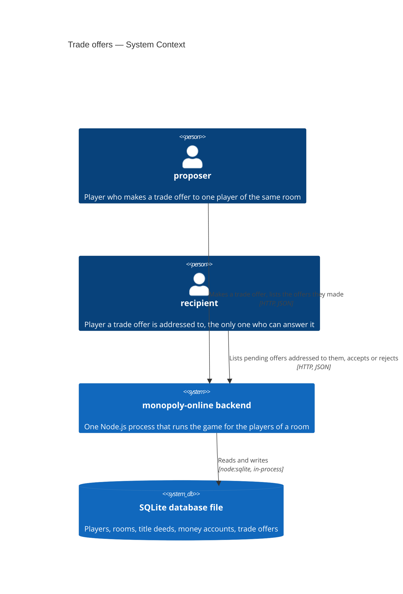
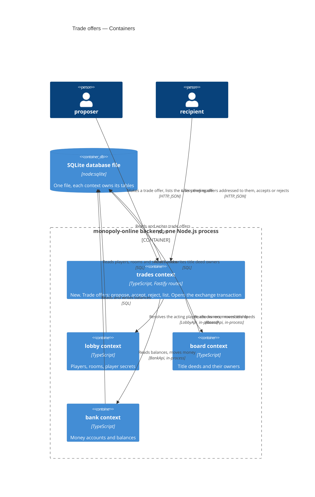
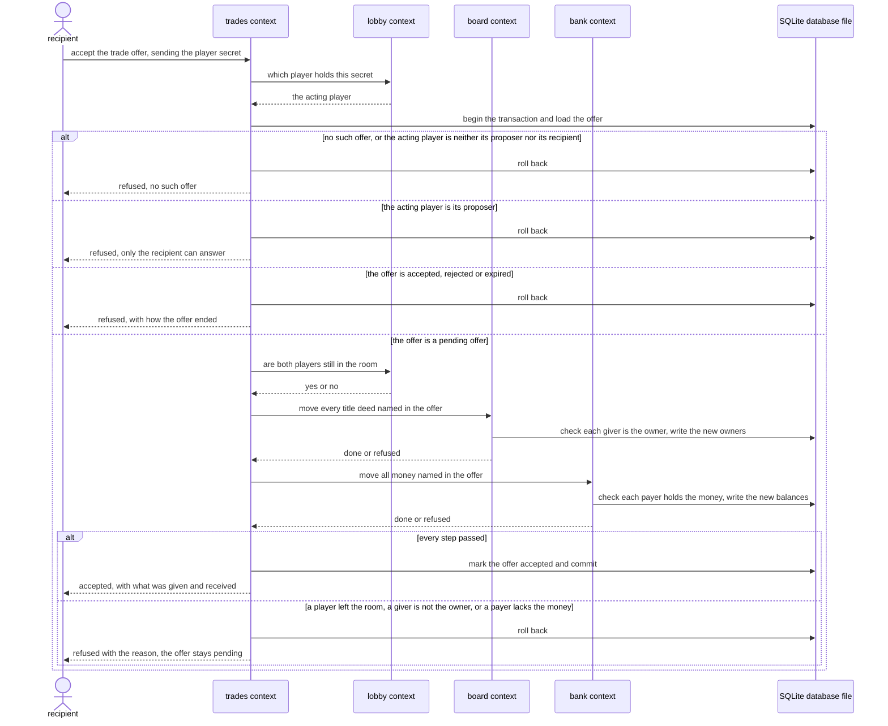
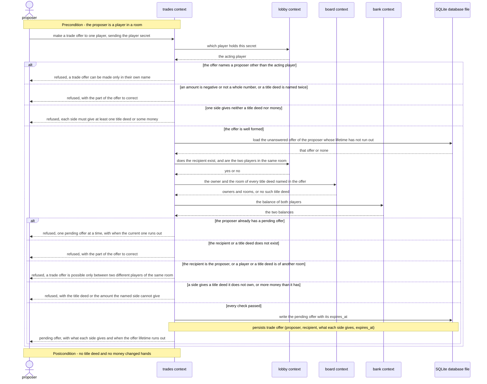
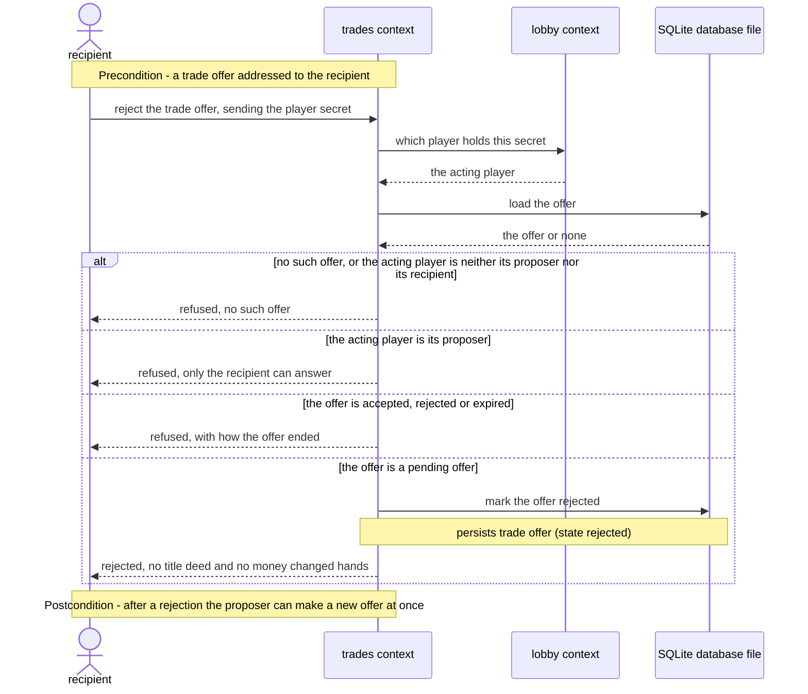
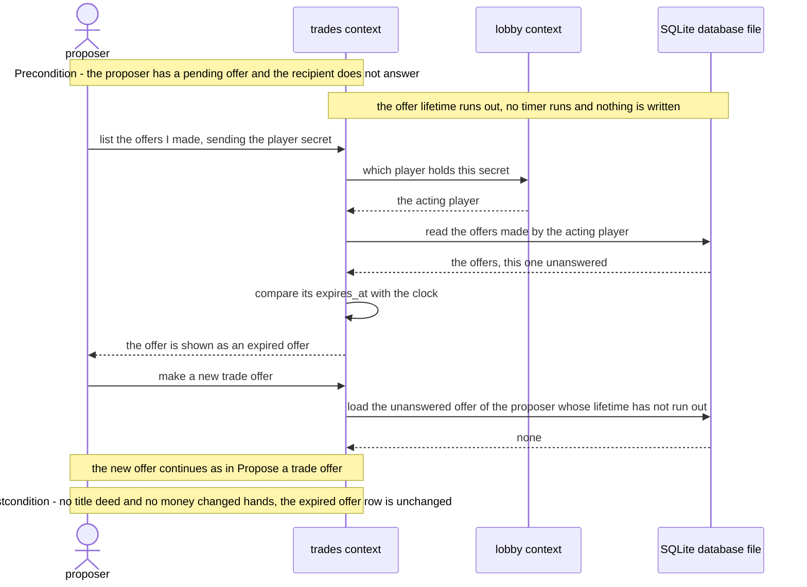
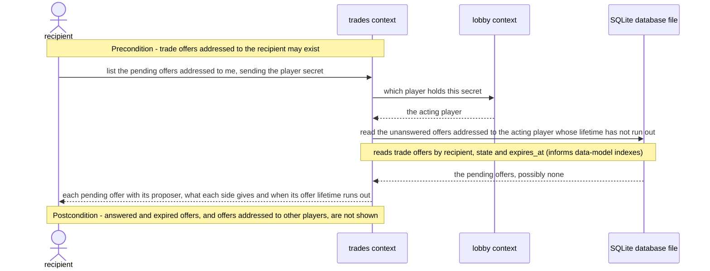
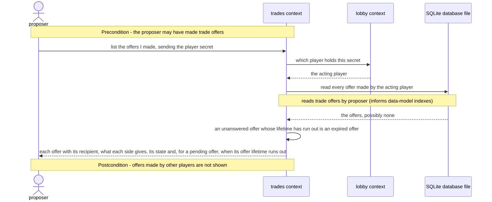

# Software Architecture Document — trade-offers

## 1. Introduction and goals

**Intent.** Players in one room can trade title deeds and money. A proposer sends one recipient a trade offer;
the recipient accepts or rejects it as a whole, or it becomes an expired offer when its offer lifetime of five
minutes runs out. An acceptance checks ownership, balances and room membership again, and then everything named
in the offer changes hands at once or nothing does. Without trading a color group comes together only by luck,
so the first full games stall ([PRD](./PRD.md) §1, §2).

**Top-3 quality goals (1-liners; full scenarios in §10):**

1. Exchange atomicity: an acceptance moves every title deed and all money named in the offer, or none of it.
2. Concurrency correctness: of two acceptances competing for one title deed, exactly one goes through.
3. Expiry accuracy: no answer is accepted after the offer lifetime has run out.

Latency is a fourth scenario in §10. It is not a driver: the stack in §2 meets the PRD targets without design
work.

**Stakeholders.**

| Role | Interest | Sign-off owner? |
|---|---|---|
| proposer | makes a trade offer and sees how it ended | No |
| recipient | finds pending offers addressed to them and answers each as a whole | No |
| Tech Lead (Kaavaal, also product owner) | approves this document and the ADRs; owns the PRD open questions | Yes |

## 2. Constraints

**Technical.**
- Node.js ≥ 24.2 (`.nvmrc`: 24), TypeScript 6.0.3, ES modules.
- Fastify 5.12.7. Every route declares a JSON schema for params, body and response.
- `node:sqlite` (`DatabaseSync`) with `PRAGMA foreign_keys = ON`: one process, one database file, every call
  synchronous. Schema changes are forward-only files `migrations/NNNN_<context>_<name>.sql`.
- Hexagonal per bounded context, checked by dependency-cruiser 18.7.0 (`pnpm arch:check`). A context reaches
  another only through its `<Ctx>Api` from `module.ts`, handed over in `src/app.ts`.
- Tests run on vitest 5.0.5 and go through HTTP with `makeTestApp()` (fresh in-memory database per call).
- What exists today: `lobby` has players (`LobbyApi.players.exists`, `nameOf`); `board` has title deeds
  (`properties`) that are not tied to a room and whose owner anyone can change; `BoardApi` is empty; `bank` and
  `turns` are empty modules.

**Organisational.**
- No external deadline; the order of upcoming work sets the urgency (PRD §1).
- Effort budget: not stated in the PRD. Tracked in §11.
- The feature is sized S on the basis that its prerequisites ship first, each as a separate feature outside
  this document (PRD §1): rooms with their players, money accounts with balances, title deeds that belong to one
  room, and a way for the product to know which player is acting.

**Conventions.**
- [CLAUDE.md](../../../CLAUDE.md) and [ARCHITECTURE.md](../../../ARCHITECTURE.md): one feature touches one
  context; the slice anatomy `domain/ → app/ → infra/ → module.ts`; `pnpm check` green before every commit.
- Errors leave domain and app code as `notFound`, `conflict` or `invalid` from `src/shared/errors.ts`. A
  uniqueness or state check belongs in the service: look up, throw, then write.
- Ids are `randomUUID()` values created in the service; timestamps are ISO 8601 strings.

**Regulatory / external.**
- No regulation applies. Data classification is internal: offers are game state of a private room, no real
  money and no personal data (PRD §6.1).
- Controls taken from PRD §6.1: only the acting player makes an offer in their own name; only the recipient
  answers; only the proposer and the recipient learn anything about an offer; a cross-room trade is refused.
- Accepted in this version (PRD §6.1): the one-coin dump, and re-sending a rejected offer at once.
- Security review: required, light. Its subject is how the product learns which player is acting; it is done in
  §4 of this document.

## 3. Context and scope

The monopoly-online backend runs the game for players who sit in one room at the same time. This feature lets
two of them, a proposer and a recipient, exchange title deeds and money through a trade offer. The system talks
to nothing outside itself: there is no identity provider, no payment service and no channel that tells a player
an offer arrived (PRD §3), so players say it out loud and look at their own offers.

The trust boundary is the HTTP interface. Everything in a request is untrusted until checked: the offer body,
the ids it names, and the claim of which player is acting. A player who is neither the proposer nor the
recipient of an offer gets no sign that it exists (PRD AC-14).

**External systems (in / out):**

| Actor or system | Type | Interaction |
|---|---|---|
| proposer | Person | Makes a trade offer to one player of the same room; lists the offers they made with their state |
| recipient | Person | Lists the pending offers addressed to them; accepts or rejects each as a whole |
| SQLite database file | Datastore (in-process library, one file) | Holds every context's tables; read and written synchronously |
| External systems | none | A deliberate choice for this version: no arrival signal, no third-party identity |

**C4 Context (L1):**



## 4. Solution strategy

**Target surface(s) (the first decision — what's being built):** `[backend-service]`

Trade offers are new HTTP/JSON routes in the existing Fastify process. There is no UI, no worker and no CLI in
the repo and the PRD asks for none, so there is no UI-architecture decision and no new deployable unit.

**Top strategic choices (the seeds for ADRs):**

1. **Own trade offers in a new `trades` context** ([ADR-0001](./adr/0001-own-trade-offers-in-a-new-trades-context.md)).
   A trade offer needs players and rooms from `lobby`, title deed owners from `board` and balances from `bank`.
   A fifth context that takes those three apis keeps `board` and `bank` unaware of each other and keeps trading
   apart from `turns`, which PRD §3 requires: offers are made and answered at any moment.
2. **Run the exchange in one SQLite transaction around guarded commands of `board` and `bank`**
   ([ADR-0002](./adr/0002-exchange-in-one-sqlite-transaction-with-guarded-commands.md)). The `trades` service
   opens the transaction; `board` moves title deeds and `bank` moves money through their apis, and each command
   refuses with `conflict` when its own rule is broken (the giver is no longer the owner, the payer lacks the
   money). Any refusal rolls everything back and the offer stays a pending offer. This serves quality goals 1
   and 2: nothing inside the transaction awaits, so two acceptances cannot interleave.
3. **Identify the acting player by a player secret that `lobby` issues**
   ([ADR-0003](./adr/0003-identify-the-acting-player-by-a-lobby-issued-secret.md)). The client sends the secret
   as a bearer credential; `trades` asks `lobby` which player it belongs to and never trusts a player id named
   in a request. This is what makes the three permission checks of PRD §6.1 enforceable, and it closes the first
   open question of PRD §8. The mechanism itself is a prerequisite feature in `lobby`.
4. **Derive expiry from the clock when an offer is read or answered** (inline, no ADR: reworking it takes under
   three days and changes no contract between contexts). An offer row stores `expires_at`, its creation time
   plus the offer lifetime of five minutes. An unanswered offer whose `expires_at` is not later than the
   current time is an expired offer, wherever it is looked at: in the two lists, in an answer attempt, and in
   the rule of one pending offer per proposer. Nothing writes an "expired" state and no timer runs, so there is
   no gap between the lifetime running out and the offer being treated as expired (quality goal 3). The clock
   is a dependency handed to `buildApp`, the system clock by default; tests pass one they control.

Each tactical decision in later sections traces to one of these. A tactical decision that contradicts one is
listed in §11.

## 5. Building block view

Hexagonal per bounded context, as in the rest of the repo. Trade offers live in a new context, `trades`
(ADR-0001), which follows the slice anatomy of ARCHITECTURE.md without change. The one declared surface,
`backend-service`, is the existing Fastify process; the diagram below shows the contexts inside it that this
feature touches.

**Internal decomposition:**

```
src/trades/
├── domain/offer.ts             trade offer type and states, validation, repository interface,
│                               what an offer needs from lobby, board and bank
├── app/service.ts              use cases: propose, accept, reject, list incoming, list outgoing
├── infra/sqlite/offerRepo.ts   repository on node:sqlite
├── infra/http/routes.ts        routes with JSON schemas; resolves the acting player
└── module.ts                   builds repo -> service -> routes; exports TradesApi
migrations/NNNN_trades_offers.sql
test/trades/offer.test.ts
```

Stored states are pending, accepted and rejected. An expired offer is derived from `expires_at` and the clock
(§4, choice 4). Withdrawn offer and dead offer are glossary terms that are not states in this version (PRD §3).

Outside `trades` the feature changes only wiring: `src/app.ts` creates the `trades` module last and hands it
`lobby.api`, `board.api`, `bank.api` and the clock; `src/shared/db.ts` gains the transaction helper (ADR-0002);
`test/helpers/app.ts` lets a test pass a clock. `TradesApi` is empty: no context uses `trades`.

**What `trades` needs from the other contexts.** These are requirements on the prerequisite features, not
part of this one. The shapes are indicative; the contract stage fixes them.

| Context | Needed through its api | Used for |
|---|---|---|
| `lobby` | the player a player secret belongs to (ADR-0003) | every route |
| `lobby` | whether a player exists; whether two players are in the same room | AC-02, AC-05, AC-18 |
| `board` | whether a title deed exists, its owner and its room | AC-02, AC-06 |
| `board` | guarded command: move title deeds between two players, refusing when a giver is not the owner | AC-07, AC-16, AC-19 |
| `bank` | the balance of a player | AC-06 |
| `bank` | guarded command: move money between two players, refusing when a payer lacks it | AC-07, AC-17 |

`turns` takes no part. `board` already calls `lobby` to check that an owner is a known player; that call is
unchanged and not drawn.

**C4 Container (L2):**



## 6. Runtime view

One flow is seeded here: accepting a trade offer. It is the only flow that crosses all four contexts and the
one the three quality goals are about. The `complete-sequence-diagrams` stage adds the remaining flows
(propose, reject, the two lists, expiry) and maps every acceptance criterion to a flow or a branch.

### Critical flow 1: accept a trade offer

PRD AC-07, AC-08, AC-09, AC-12, AC-14, AC-16 to AC-19.



The first refusal ends the flow: later steps do not run, and the rollback undoes any step that already wrote.
Nothing between "begin the transaction" and "commit" or "roll back" awaits, so a second acceptance that
competes for the same title deed or the same money starts after this one has finished and takes the refused
branch (ADR-0002).

**Critical flow 2:** not seeded in this pass. The feature has no asynchronous step and no event; the other
flows are synchronous and are drawn by `complete-sequence-diagrams`.

The flows below were added by `complete-sequence-diagrams`. They use the participants of critical flow 1. In
every flow a request without a player secret, or with an unknown one, is refused as `unauthorized` before
anything else (§8); that refusal is not drawn.

### Propose a trade offer



A rejected, accepted or expired offer does not count as the proposer's pending offer, so the same offer made
again right after a rejection is recorded as a new pending offer with its own offer lifetime (AC-10b). The
order of the refusals when several apply at once is not fixed here; the contract stage fixes it.

### Reject a trade offer



### Let an unanswered offer expire



An answer to an expired offer takes the "accepted, rejected or expired" branch of the accept and reject flows
(AC-12).

### List pending offers addressed to me



### List the offers I made



### Coverage: US/AC → flows

| ID | Realized by (§6 heading) | How | Note |
|---|---|---|---|
| US-01 | `Propose a trade offer` | flow | |
| US-02 | `Critical flow 1: accept a trade offer` | flow | |
| US-03 | `Reject a trade offer` | flow | |
| US-04 | `Let an unanswered offer expire` | flow | |
| US-05 | `List pending offers addressed to me` | flow | |
| US-06 | `List the offers I made` | flow | |
| US-07 | `Critical flow 1: accept a trade offer` | flow | the inner `alt` after the re-check |
| AC-01 | `Propose a trade offer` | flow | |
| AC-02 | `Propose a trade offer` | branch | `else an amount is negative or not a whole number, or a title deed is named twice` and `else the recipient or a title deed does not exist` |
| AC-03 | `Propose a trade offer` | branch | `else one side gives neither a title deed nor money` |
| AC-04 | `Propose a trade offer` | branch | `alt the proposer already has a pending offer` |
| AC-05 | `Propose a trade offer` | branch | `else the recipient is the proposer, or a player or a title deed is of another room` |
| AC-06 | `Propose a trade offer` | branch | `else a side gives a title deed it does not own, or more money than it has` |
| AC-06b | `Propose a trade offer` | branch | `alt the offer names a proposer other than the acting player` |
| AC-07 | `Critical flow 1: accept a trade offer` | flow | |
| AC-08 | `Critical flow 1: accept a trade offer`, `Reject a trade offer` | branch | `else the acting player is its proposer` |
| AC-09 | `Critical flow 1: accept a trade offer`, `Reject a trade offer` | branch | `else the offer is accepted, rejected or expired` |
| AC-10 | `Reject a trade offer` | flow | |
| AC-10b | `Propose a trade offer` | flow | the pending check counts no rejected offer, see the paragraph under the diagram |
| AC-11 | `Let an unanswered offer expire` | flow | |
| AC-12 | `Critical flow 1: accept a trade offer`, `Reject a trade offer` | branch | `else the offer is accepted, rejected or expired` |
| AC-13 | `List pending offers addressed to me` | flow | |
| AC-14 | `Critical flow 1: accept a trade offer`, `Reject a trade offer` | branch | `alt no such offer, or the acting player is neither its proposer nor its recipient`. Seeing: both list flows read only the offers of the acting player |
| AC-15 | `List the offers I made` | flow | |
| AC-16 | `Critical flow 1: accept a trade offer` | branch | `else a player left the room, a giver is not the owner, or a payer lacks the money` |
| AC-17 | `Critical flow 1: accept a trade offer` | branch | `else a player left the room, a giver is not the owner, or a payer lacks the money` |
| AC-18 | `Critical flow 1: accept a trade offer` | branch | `else a player left the room, a giver is not the owner, or a payer lacks the money` |
| AC-19 | `Critical flow 1: accept a trade offer` | branch | the second acceptance takes the same refused branch, see the paragraph under the diagram |

Coverage: 7/7 user stories · 21/21 ACs — 0 non-runtime N/A.

**Flags:**
- Participants are the contexts of §5 (`trades`, `lobby`, `board`, `bank`, the SQLite file), as in critical
  flow 1, not the generic vocabulary of the stage. Chosen by the owner for one look across §6. No participant
  outside §5 was added.
- The order of the refusals in `Propose a trade offer` when several apply at once is open; for the contract
  stage (`/sdlc:api-forge`).
- Reads that the data model has to serve: the unanswered, unexpired offer of a proposer (propose); offers by
  recipient, state and `expires_at` (incoming list); offers by proposer (outgoing list).
- No decision worth an ADR came up.

## 7. Deployment view

<!-- N/A: the feature reuses the existing deployment unit; no change to replicas, scaling or monitoring -->

Trade offers run inside the one Node.js process started by `src/index.ts`, on the same SQLite file
(`DB_PATH`, default `monopoly.db`). The feature adds a migration, applied at start like the others, and no
process, port, environment variable or scheduled job. The product has no production deployment and no SLO
window yet (PRD §6).

## 8. Crosscutting concepts

Trade offers follow the conventions of the repo. Only the rows marked "new" add something.

| Concept | Convention | Where defined |
|---|---|---|
| Authentication (new) | The client sends a player secret as a bearer credential; `trades` resolves the acting player through `LobbyApi`. No secret or an unknown one: HTTP 401, kind `unauthorized` | ADR-0003; built by the `lobby` prerequisite |
| Authorization (new) | Checked in the `trades` service against the acting player id. The proposer of an offer is always the acting player. The request body may name a proposer; when it names a player other than the acting player, the service refuses with `invalid` and says that a trade offer can be made only in one's own name (AC-06b). When it names none, the proposer is the acting player | here |
| Error handling | The three kinds of `src/shared/errors.ts`, no new kind from this feature; `unauthorized` comes with the `lobby` prerequisite (ADR-0003). A request that is wrong on its own, or names a player or title deed that does not exist: `invalid`. A well-formed request that the current state or the acting player's role does not allow (a pending offer already exists, the offer is already answered or expired, the re-check at acceptance fails, the proposer answers their own offer): `conflict`. An offer the acting player is not a side of, or that does not exist: `not_found`, with the same message in both cases (AC-14). The message names the title deed or the side concerned (AC-06, AC-16, AC-17) | CLAUDE.md, ARCHITECTURE.md |
| Transactions (new) | One helper in `src/shared/db.ts`, used only by a use case that writes in more than one context. Its body is synchronous; a command called inside joins the open transaction | ADR-0002 |
| Time (new) | The clock is a dependency of `buildApp`. `trades` reads the time only from it. Timestamps are ISO 8601 strings in UTC | §4, choice 4 |
| Validation | A JSON schema on every route for params, body and response; the domain checks again | CLAUDE.md |
| ID strategy | `randomUUID()` in the service | existing code in `lobby` and `board` |
| Money | Whole numbers, stored as SQLite `INTEGER`; a negative or fractional amount is `invalid` (AC-02) | here; owned by `bank` |
| Logging | The Fastify request logger enabled in `src/index.ts`; an unexpected error is logged by `src/shared/http.ts`. One line of its own (new): an acceptance refused by the re-check writes a structured line to the request log with the offer id and the reason (a title deed has a new owner, a side lacks the money, a player left the room) | existing code |
| Observability | Refused acceptances (PRD §7) is counted from the refusal lines above against all acceptance attempts in the request log. The other KPIs of PRD §7 are counted from the offers table and by hand during trial games | PRD §7 |
| Internationalisation | N/A, messages in English | — |
| Outbox / events | N/A: no event leaves `trades` and nothing tells a player an offer arrived (PRD §3) | — |
| Rate limiting | None. Offer flooding is bounded by one pending offer per proposer (PRD §6.1) | PRD §6.1 |

## 9. Architecture decisions

| # | Title | Status | Section |
|---|---|---|---|
| [0001](./adr/0001-own-trade-offers-in-a-new-trades-context.md) | Own trade offers in a new `trades` context | Accepted | §4 |
| [0002](./adr/0002-exchange-in-one-sqlite-transaction-with-guarded-commands.md) | Run the exchange in one SQLite transaction around guarded commands of `board` and `bank` | Accepted | §4 |
| [0003](./adr/0003-identify-the-acting-player-by-a-lobby-issued-secret.md) | Identify the acting player by a player secret that `lobby` issues | Accepted | §4 |

ADR files live under `docs/features/trade-offers/adr/`. Decisions kept inline because they did not cross the
blast-radius gate: expiry derived from the clock (§4, choice 4) and no new error kind from this feature (§8).

## 10. Quality requirements

Each quality goal of §1 as a scenario. Targets are quoted from PRD §6. All scenarios are checked in
`test/trades/offer.test.ts` through HTTP with `makeTestApp()`.

**QG-1. Exchange atomicity**
- **When:** a recipient accepts a pending offer, whether the exchange goes through or fails midway.
- **Then:** "0 partial exchanges: after every acceptance attempt the total money in the room is unchanged and
  every title deed has exactly one owner" (PRD §6).
- **How verify:** an invariant check after each acceptance in the automated tests: the sum of the balances of
  the players of the room before and after, and the owner of every title deed named in the offer. It includes
  a run in which the exchange is made to fail midway: an offer whose title deed leg holds and whose money leg
  the payer cannot cover. The test asserts that the title deed kept its owner and the offer is still a pending
  offer.

**QG-2. Concurrency correctness**
- **When:** two pending offers give away the same title deed and both recipients accept at the same moment.
- **Then:** "of 2 acceptances competing for one title deed, exactly 1 goes through, in 100 of 100 repetitions"
  (PRD §6); the other is refused as in AC-16, and the invariants of QG-1 hold.
- **How verify:** a repeated automated test, 100 repetitions, each on a fresh app: the two acceptance requests
  are sent together and the test expects one success, one `conflict` and the QG-1 invariants. Under ADR-0002
  two requests in one process cannot interleave, so this test guards the design (it fails if an `await` is
  ever put inside the transaction) and does not search for a race.

**QG-3. Expiry accuracy**
- **When:** a recipient accepts or rejects an offer whose offer lifetime of five minutes has run out, including
  an answer sent in the last moment that arrives after it.
- **Then:** "0 answers accepted after the five-minute lifetime has run out" (PRD §6): the answer is refused,
  the offer is an expired offer and nothing changes hands (AC-12).
- **How verify:** an automated test with a controlled clock handed to the app: an answer one millisecond before
  `expires_at` is taken; an answer at `expires_at` and one millisecond after it is refused with `conflict`,
  and the QG-1 invariants hold.

**QG-4. Latency** (not a top-3 goal)
- **When:** a player makes or answers an offer, or lists their offers.
- **Then:** "p95 ≤ 250 ms" for making or answering an offer and "p95 ≤ 150 ms" for listing a player's offers
  (PRD §6).
- **How verify:** the "server-side duration of the propose, accept and reject actions" and of "the two list
  actions", "sampled in the automated test run" (PRD §6). The PRD gives no sample size; the test plan sets it.

Availability: N/A. The product has no production deployment and no SLO window yet (PRD §6).

## 11. Risks and technical debt

| Risk / debt | Severity | Mitigation | Owner |
|---|---|---|---|
| With no signal that an offer arrived, the recipient does not notice it, offers expire and players give up trading | Medium | Over the first five trial tables, look at the share of expired offers; if it is above 40%, bring the arrival signal back into the plan. That is the point at which the Answered offers KPI of PRD §7 (at least 60% answered) is missed | Kaavaal |
| None of the four prerequisites exists in the code: rooms with their players, money accounts, title deeds that belong to one room, the player secret. Trade offers can be neither built nor tested before them | High | Each is a separate feature. Their order is an open question of PRD §8, due before `/sdlc:break-tasks`. §5 lists what `trades` needs from each api | Kaavaal |
| Two PRDs describe this feature and disagree: `PRD.md` and `game-prd.md` differ in the latency targets, in whether the recipient's money is checked when an offer is made, and in the numbering of acceptance criteria. This document follows `PRD.md` only | Medium | Bring the two into line or retire one before `/sdlc:break-tasks`; then re-check §10 against the surviving numbers | Kaavaal |
| Today anyone can change the owner of a title deed through the existing `board` route, past the guarded command of ADR-0002 | Medium | The prerequisite feature for title deeds that belong to one room restricts or removes that path; until then the QG-1 invariants hold only for changes made through `trades` | Kaavaal |
| Atomicity and the single winner of a race rest on a convention no tool checks: nothing awaits between the start and the end of the exchange transaction. The QG-2 test guards it and does not search for races | Medium | Review; the QG-2 repeated test; the rule is written in §8 and ADR-0002 | Kaavaal |
| The player secret travels over plain HTTP, cannot be rotated or revoked, and guesses are not rate-limited | Low | Accepted for trial tables on one local network (ADR-0003). Revisit before the backend is reachable from outside it | Kaavaal |
| The exchange transaction spans writes of three contexts and works only while they share one database file | Low | Recorded in ADR-0002; a context that moves to its own store turns the exchange into a saga | Kaavaal |
| The PRD states no effort budget (§2) | Low | Set when the work is broken down at `/sdlc:break-tasks` | Kaavaal |
| The current architecture was read from ARCHITECTURE.md and the code at commit `338436d`; there is no `docs/architecture-map.md`, and the prerequisite features will change `lobby`, `board` and `bank` before this one is built | Low | Run `/sdlc:map-architecture`; re-read §5 against the real apis once the prerequisites land | Kaavaal |

No architectural decision was left open in this pass. The open questions of PRD §8 that are not architecture
(what a finished game is, whether five minutes is the right offer lifetime) stay with the PRD.

**Accepted debt (acceptable in this version, plan to fix later):**
- An expired offer is not stored as a state; it is derived from `expires_at` and the clock, so the KPIs of
  PRD §7 are counted by a query that compares times.
- An offer that can no longer be honoured stays a pending offer until it expires (PRD §3). If refused
  acceptances pass 10% of attempts, closing such offers comes back (PRD §7).
- The one-coin dump is allowed (PRD §6.1).
- The offer lifetime is one constant in `trades`; changing it after trial tables is a one-line change.

## 12. Glossary

Domain terms come from [CONTEXT.md](./CONTEXT.md), which stays the canonical source. The last four rows are
terms this document introduced; they name how the design works, so they stay here and CONTEXT.md links to
acting player.

| Term | Meaning |
|---|---|
| trade offer | A proposal from one player to another player in the same room to give their own title deeds and/or money in exchange for the other's; accepted or rejected as a whole, expires if left unanswered. Not a transfer |
| proposer | The player who creates a trade offer and names what they give and what they ask for in return |
| recipient | The one player a trade offer is addressed to and the only player who can accept or reject it |
| pending offer | A trade offer the recipient has not answered and whose lifetime has not run out; the only kind that can be accepted or rejected |
| accepted offer | A trade offer the recipient accepted and whose exchange took place in full. Not an acceptance attempt |
| rejected offer | A trade offer the recipient explicitly refused |
| expired offer | A trade offer the recipient did not answer within its lifetime |
| offer lifetime | The fixed time a trade offer stays pending after it is created, the same for every offer: five minutes |
| dead offer, withdrawn offer | Glossary terms for behaviour that is not part of this version; neither is a state here |
| room | The group of players who play one game together on one board; trade offers are possible only inside one room |
| color group | The fixed set of title deeds of one color, as defined by the rules of the game |
| acting player | The player a request is made by, established from the player secret; never taken from a player id named in the request |
| player secret | A random value `lobby` issues once when a player is created and that proves who is acting. Not the player's `token`, which is the piece on the board |
| exchange | What an acceptance carries out: every title deed and all money named in a trade offer change hands in one transaction |
| guarded command | A command in a context's api that checks that context's own rule before it writes and refuses with `conflict` when the rule is broken |
