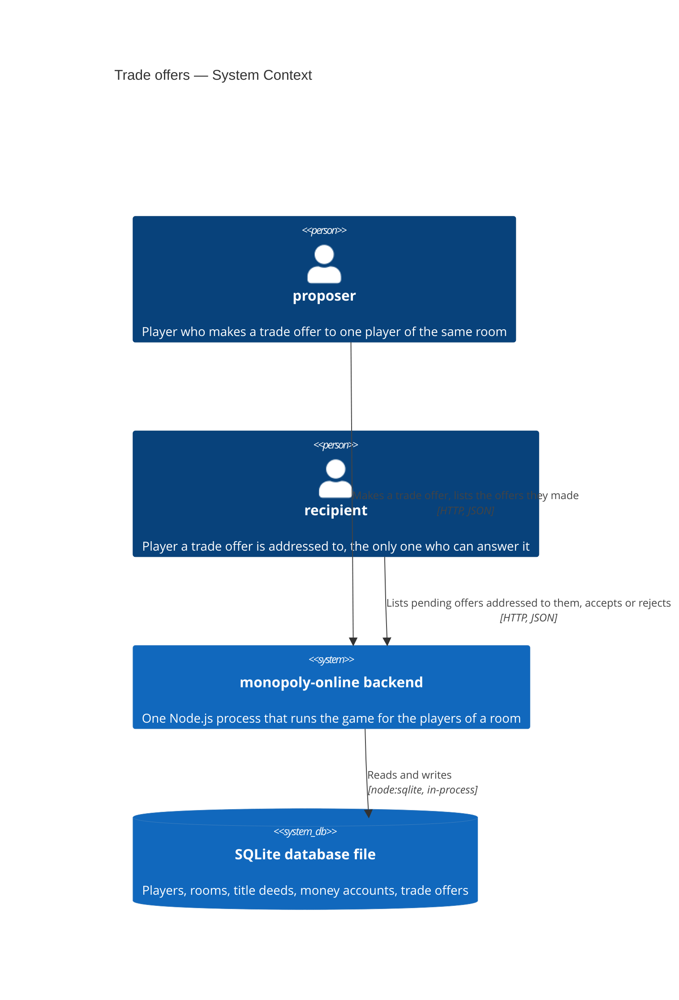
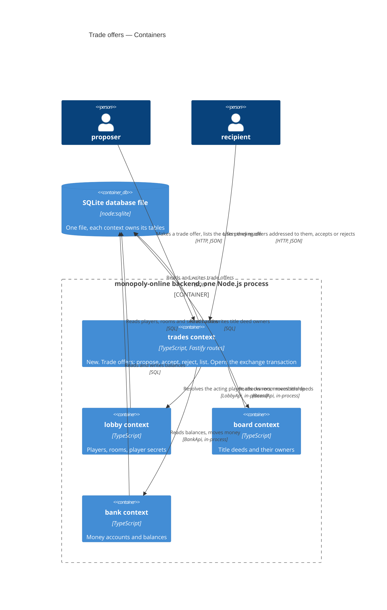
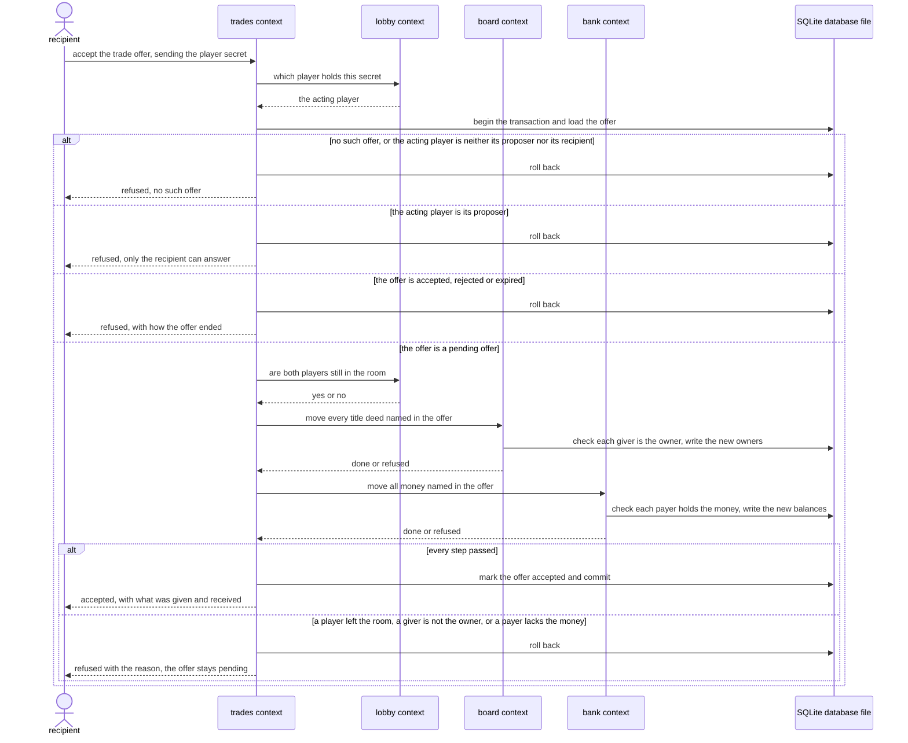

# Software Architecture Document — trade-offers

## 1. Introduction and goals

**Intent.** Players in one room can trade title deeds and money. A proposer sends one recipient a trade offer;
the recipient accepts or rejects it as a whole, or it becomes an expired offer when its offer lifetime of five
minutes runs out. An acceptance checks ownership, balances and room membership again, and then everything named
in the offer changes hands at once or nothing does. Without trading a color group comes together only by luck,
so the first full games stall ([PRD](./PRD.md) §1, §2).

**Top-3 quality goals (1-liners; full scenarios in §10):**

1. Exchange atomicity: an acceptance moves every title deed and all money named in the offer, or none of it.
2. Concurrency correctness: of two acceptances competing for one title deed, exactly one goes through.
3. Expiry accuracy: no answer is accepted after the offer lifetime has run out.

Latency is a fourth scenario in §10. It is not a driver: the stack in §2 meets the PRD targets without design
work.

**Stakeholders.**

| Role | Interest | Sign-off owner? |
|---|---|---|
| proposer | makes a trade offer and sees how it ended | No |
| recipient | finds pending offers addressed to them and answers each as a whole | No |
| Tech Lead (Kaavaal, also product owner) | approves this document and the ADRs; owns the PRD open questions | Yes |

## 2. Constraints

**Technical.**
- Node.js ≥ 24.2 (`.nvmrc`: 24), TypeScript 6.0.3, ES modules.
- Fastify 5.12.7. Every route declares a JSON schema for params, body and response.
- `node:sqlite` (`DatabaseSync`) with `PRAGMA foreign_keys = ON`: one process, one database file, every call
  synchronous. Schema changes are forward-only files `migrations/NNNN_<context>_<name>.sql`.
- Hexagonal per bounded context, checked by dependency-cruiser 18.7.0 (`pnpm arch:check`). A context reaches
  another only through its `<Ctx>Api` from `module.ts`, handed over in `src/app.ts`.
- Tests run on vitest 5.0.5 and go through HTTP with `makeTestApp()` (fresh in-memory database per call).
- What exists today: `lobby` has players (`LobbyApi.players.exists`, `nameOf`); `board` has title deeds
  (`properties`) that are not tied to a room and whose owner anyone can change; `BoardApi` is empty; `bank` and
  `turns` are empty modules.

**Organisational.**
- No external deadline; the order of upcoming work sets the urgency (PRD §1).
- Effort budget: not stated in the PRD. Tracked in §11.
- The feature is sized S on the basis that its prerequisites ship first, each as a separate feature outside
  this document (PRD §1): rooms with their players, money accounts with balances, title deeds that belong to one
  room, and a way for the product to know which player is acting.

**Conventions.**
- [CLAUDE.md](../../../CLAUDE.md) and [ARCHITECTURE.md](../../../ARCHITECTURE.md): one feature touches one
  context; the slice anatomy `domain/ → app/ → infra/ → module.ts`; `pnpm check` green before every commit.
- Errors leave domain and app code as `notFound`, `conflict` or `invalid` from `src/shared/errors.ts`. A
  uniqueness or state check belongs in the service: look up, throw, then write.
- Ids are `randomUUID()` values created in the service; timestamps are ISO 8601 strings.

**Regulatory / external.**
- No regulation applies. Data classification is internal: offers are game state of a private room, no real
  money and no personal data (PRD §6.1).
- Controls taken from PRD §6.1: only the acting player makes an offer in their own name; only the recipient
  answers; only the proposer and the recipient learn anything about an offer; a cross-room trade is refused.
- Accepted in this version (PRD §6.1): the one-coin dump, and re-sending a rejected offer at once.
- Security review: required, light. Its subject is how the product learns which player is acting; it is done in
  §4 of this document.

## 3. Context and scope

The monopoly-online backend runs the game for players who sit in one room at the same time. This feature lets
two of them, a proposer and a recipient, exchange title deeds and money through a trade offer. The system talks
to nothing outside itself: there is no identity provider, no payment service and no channel that tells a player
an offer arrived (PRD §3), so players say it out loud and look at their own offers.

The trust boundary is the HTTP interface. Everything in a request is untrusted until checked: the offer body,
the ids it names, and the claim of which player is acting. A player who is neither the proposer nor the
recipient of an offer gets no sign that it exists (PRD AC-14).

**External systems (in / out):**

| Actor or system | Type | Interaction |
|---|---|---|
| proposer | Person | Makes a trade offer to one player of the same room; lists the offers they made with their state |
| recipient | Person | Lists the pending offers addressed to them; accepts or rejects each as a whole |
| SQLite database file | Datastore (in-process library, one file) | Holds every context's tables; read and written synchronously |
| External systems | none | A deliberate choice for this version: no arrival signal, no third-party identity |

**C4 Context (L1):**



## 4. Solution strategy

**Target surface(s) (the first decision — what's being built):** `[backend-service]`

Trade offers are new HTTP/JSON routes in the existing Fastify process. There is no UI, no worker and no CLI in
the repo and the PRD asks for none, so there is no UI-architecture decision and no new deployable unit.

**Top strategic choices (the seeds for ADRs):**

1. **Own trade offers in a new `trades` context** ([ADR-0001](./adr/0001-own-trade-offers-in-a-new-trades-context.md)).
   A trade offer needs players and rooms from `lobby`, title deed owners from `board` and balances from `bank`.
   A fifth context that takes those three apis keeps `board` and `bank` unaware of each other and keeps trading
   apart from `turns`, which PRD §3 requires: offers are made and answered at any moment.
2. **Run the exchange in one SQLite transaction around guarded commands of `board` and `bank`**
   ([ADR-0002](./adr/0002-exchange-in-one-sqlite-transaction-with-guarded-commands.md)). The `trades` service
   opens the transaction; `board` moves title deeds and `bank` moves money through their apis, and each command
   refuses with `conflict` when its own rule is broken (the giver is no longer the owner, the payer lacks the
   money). Any refusal rolls everything back and the offer stays a pending offer. This serves quality goals 1
   and 2: nothing inside the transaction awaits, so two acceptances cannot interleave.
3. **Identify the acting player by a player secret that `lobby` issues**
   ([ADR-0003](./adr/0003-identify-the-acting-player-by-a-lobby-issued-secret.md)). The client sends the secret
   as a bearer credential; `trades` asks `lobby` which player it belongs to and never trusts a player id named
   in a request. This is what makes the three permission checks of PRD §6.1 enforceable, and it closes the first
   open question of PRD §8. The mechanism itself is a prerequisite feature in `lobby`.
4. **Derive expiry from the clock when an offer is read or answered** (inline, no ADR: reworking it takes under
   three days and changes no contract between contexts). An offer row stores `expires_at`, its creation time
   plus the offer lifetime of five minutes. An unanswered offer whose `expires_at` is not later than the
   current time is an expired offer, wherever it is looked at: in the two lists, in an answer attempt, and in
   the rule of one pending offer per proposer. Nothing writes an "expired" state and no timer runs, so there is
   no gap between the lifetime running out and the offer being treated as expired (quality goal 3). The clock
   is a dependency handed to `buildApp`, the system clock by default; tests pass one they control.

Each tactical decision in later sections traces to one of these. A tactical decision that contradicts one is
listed in §11.

## 5. Building block view

Hexagonal per bounded context, as in the rest of the repo. Trade offers live in a new context, `trades`
(ADR-0001), which follows the slice anatomy of ARCHITECTURE.md without change. The one declared surface,
`backend-service`, is the existing Fastify process; the diagram below shows the contexts inside it that this
feature touches.

**Internal decomposition:**

```
src/trades/
├── domain/offer.ts             trade offer type and states, validation, repository interface,
│                               what an offer needs from lobby, board and bank
├── app/service.ts              use cases: propose, accept, reject, list incoming, list outgoing
├── infra/sqlite/offerRepo.ts   repository on node:sqlite
├── infra/http/routes.ts        routes with JSON schemas; resolves the acting player
└── module.ts                   builds repo -> service -> routes; exports TradesApi
migrations/NNNN_trades_offers.sql
test/trades/offer.test.ts
```

Stored states are pending, accepted and rejected. An expired offer is derived from `expires_at` and the clock
(§4, choice 4). Withdrawn offer and dead offer are glossary terms that are not states in this version (PRD §3).

Outside `trades` the feature changes only wiring: `src/app.ts` creates the `trades` module last and hands it
`lobby.api`, `board.api`, `bank.api` and the clock; `src/shared/db.ts` gains the transaction helper (ADR-0002);
`test/helpers/app.ts` lets a test pass a clock. `TradesApi` is empty: no context uses `trades`.

**What `trades` needs from the other contexts.** These are requirements on the prerequisite features, not
part of this one. The shapes are indicative; the contract stage fixes them.

| Context | Needed through its api | Used for |
|---|---|---|
| `lobby` | the player a player secret belongs to (ADR-0003) | every route |
| `lobby` | whether a player exists; whether two players are in the same room | AC-02, AC-05, AC-18 |
| `board` | whether a title deed exists, its owner and its room | AC-02, AC-06 |
| `board` | guarded command: move title deeds between two players, refusing when a giver is not the owner | AC-07, AC-16, AC-19 |
| `bank` | the balance of a player | AC-06 |
| `bank` | guarded command: move money between two players, refusing when a payer lacks it | AC-07, AC-17 |

`turns` takes no part. `board` already calls `lobby` to check that an owner is a known player; that call is
unchanged and not drawn.

**C4 Container (L2):**



## 6. Runtime view

One flow is seeded here: accepting a trade offer. It is the only flow that crosses all four contexts and the
one the three quality goals are about. The `complete-sequence-diagrams` stage adds the remaining flows
(propose, reject, the two lists, expiry) and maps every acceptance criterion to a flow or a branch.

**Critical flow 1: accept a trade offer** (PRD AC-07, AC-08, AC-09, AC-12, AC-14, AC-16 to AC-19)



The first refusal ends the flow: later steps do not run, and the rollback undoes any step that already wrote.
Nothing between "begin the transaction" and "commit" or "roll back" awaits, so a second acceptance that
competes for the same title deed or the same money starts after this one has finished and takes the refused
branch (ADR-0002).

**Critical flow 2:** not seeded in this pass. The feature has no asynchronous step and no event; the other
flows are synchronous and are drawn by `complete-sequence-diagrams`.

## 7. Deployment view

<!-- N/A: the feature reuses the existing deployment unit; no change to replicas, scaling or monitoring -->

Trade offers run inside the one Node.js process started by `src/index.ts`, on the same SQLite file
(`DB_PATH`, default `monopoly.db`). The feature adds a migration, applied at start like the others, and no
process, port, environment variable or scheduled job. The product has no production deployment and no SLO
window yet (PRD §6).

## 8. Crosscutting concepts

Trade offers follow the conventions of the repo. Only the rows marked "new" add something.

| Concept | Convention | Where defined |
|---|---|---|
| Authentication (new) | The client sends a player secret as a bearer credential; `trades` resolves the acting player through `LobbyApi`. No secret or an unknown one: HTTP 401, kind `unauthorized` | ADR-0003; built by the `lobby` prerequisite |
| Authorization (new) | Checked in the `trades` service against the acting player id. The proposer of an offer is always the acting player: the request body has no proposer field, and unknown body fields already fail validation, so an offer in someone else's name cannot be expressed (AC-06b) | here |
| Error handling | The three kinds of `src/shared/errors.ts`, no new kind from this feature. A request that is wrong on its own, or names a player or title deed that does not exist: `invalid`. A well-formed request that the current state or the acting player's role does not allow (a pending offer already exists, the offer is already answered or expired, the re-check at acceptance fails, the proposer answers their own offer): `conflict`. An offer the acting player is not a side of, or that does not exist: `not_found`, with the same message in both cases (AC-14). The message names the title deed or the side concerned (AC-06, AC-16, AC-17) | CLAUDE.md, ARCHITECTURE.md |
| Transactions (new) | One helper in `src/shared/db.ts`, used only by a use case that writes in more than one context. Its body is synchronous; a command called inside joins the open transaction | ADR-0002 |
| Time (new) | The clock is a dependency of `buildApp`. `trades` reads the time only from it. Timestamps are ISO 8601 strings in UTC | §4, choice 4 |
| Validation | A JSON schema on every route for params, body and response; the domain checks again | CLAUDE.md |
| ID strategy | `randomUUID()` in the service | existing code in `lobby` and `board` |
| Money | Whole numbers, stored as SQLite `INTEGER`; a negative or fractional amount is `invalid` (AC-02) | here; owned by `bank` |
| Logging | The Fastify request logger enabled in `src/index.ts`; an unexpected error is logged by `src/shared/http.ts`. No log line of its own for an offer or an exchange | existing code |
| Observability | None beyond request logs. The KPIs of PRD §7 are counted from the offers table and by hand during trial games | PRD §7 |
| Internationalisation | N/A, messages in English | — |
| Outbox / events | N/A: no event leaves `trades` and nothing tells a player an offer arrived (PRD §3) | — |
| Rate limiting | None. Offer flooding is bounded by one pending offer per proposer (PRD §6.1) | PRD §6.1 |

## 9. Architecture decisions

| # | Title | Status | Section |
|---|---|---|---|
| [0001](./adr/0001-own-trade-offers-in-a-new-trades-context.md) | Own trade offers in a new `trades` context | Accepted | §4 |
| [0002](./adr/0002-exchange-in-one-sqlite-transaction-with-guarded-commands.md) | Run the exchange in one SQLite transaction around guarded commands of `board` and `bank` | Accepted | §4 |
| [0003](./adr/0003-identify-the-acting-player-by-a-lobby-issued-secret.md) | Identify the acting player by a player secret that `lobby` issues | Accepted | §4 |

ADR files live under `docs/features/trade-offers/adr/`. Decisions kept inline because they did not cross the
blast-radius gate: expiry derived from the clock (§4, choice 4) and no new error kind from this feature (§8).

## 10. Quality requirements

<!-- 🎯 Навіщо: ДЕРЕВО ЯКОСТЕЙ (Quality Tree) — беремо мету з §1 і розкладаємо на          -->
<!--           конкретні листя: тести, метрики, конфіги, drill-и. ⭐ Без §10 §1 — це       -->
<!--           маніфест. З §10 кожна декларація мапиться на щось, ЩО МОЖНА ДОВЕСТИ.        -->
<!-- 📋 Що писати: на кожну якість з §1 — When / Then / How verify. Числа з PRD §6 NFR     -->
<!--           ДОСЛІВНО (не округлюй p95 ≤250мс до ≤300мс — це F6-помилка критика).        -->
<!-- 📌 Приклад: «p95 ≤500 мс на UPDATE блоку, перевіримо k6 load test 100 req/s».        -->

Each top-3 goal from §1 expanded into a full scenario:

**QG-1. <quality attribute>**
- **When:** <trigger condition>
- **Then:** <expected behavior with numbers from PRD NFR>
- **How verify:** <test / chaos drill / load test / observability>

**QG-2. <quality attribute>**
- **When:** <trigger>
- **Then:** <expected>
- **How verify:** <how>

**QG-3. <quality attribute>**
- **When:** <trigger>
- **Then:** <expected>
- **How verify:** <how>

## 11. Risks and technical debt

<!-- 🎯 Навіщо: ⭐ збирає ВСЕ, що може зламатись — і не лише технічне. Без §11 ризики   -->
<!--           обговорюються на стендапах і губляться; борг лишається у голові того,    -->
<!--           хто його прийняв.                                                          -->
<!-- 📋 Що писати: таблиця ризик/борг — серйозність — мітигація — власник. Технічний    -->
<!--           борг окремою секцією.                                                      -->
<!-- 📌 Приклад: «EM не пушить — member не оновлює дані | High | …». Перший ризик —      -->
<!--           часто продуктовий, не технічний. Це нормально.                            -->

<!-- Severity column literals: Low / Medium / High for regular risks; "Open question" for rows
     created by Step-7 `Save as Open Question` resolutions (see references/socratic-loop.md). -->

| Risk / debt | Severity | Mitigation | Owner |
|---|---|---|---|
| <e.g. Outbox lag may reach hours during downstream outage> | Medium | <Alert >10 min, on-call playbook, retry backoff> | <DevOps> |
| <e.g. No event schema versioning in v1> | Medium | <ADR-NNNN planned for v2, graceful handling of unknown fields> | <Backend> |
| Open architectural decision: <decision-headline> | Open question | Resolve before <stage trigger or YYYY-MM-DD>; <inline rationale from Step-7 Save-as-OQ> | <owner> |

**Accepted debt (acceptable in v1, plan to fix later):**
- <e.g. Goal entity is not versioned (immutable) — OK for v1, may need audit versioning in v2>

## 12. Glossary

<!-- 🎯 Навіщо: ⭐ СЛОВНИК ДОМЕНУ, який припиняє суперечки через рік («checkpoint —      -->
<!--           weekly чи biweekly? Quarter — календарний чи фіскальний?»).                -->
<!-- 📋 Що писати: таблиця термін / значення. Бізнес-терміни + технічні вперемішку.       -->
<!--           Один термін може мати дві мови у заголовку: «Goal (Обʼєктив)».              -->
<!-- 📌 Приклад: «Lesson | урок усередині курсу, що складається з блоків (text, video)». -->

| Term | Meaning |
|---|---|
| <e.g. Goal> | <quarterly intent in statement form> |
| <e.g. KR> | <Key Result — measurable target linked to a Goal> |
| <e.g. Checkpoint> | <bi-weekly progress update on a KR> |
