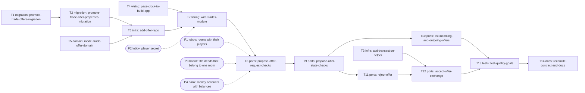

# Epic — trade-offers

> **PRD:** [PRD.md](../PRD.md) · **Design:** [sad.md](../sad.md) · **Data model:** [data-model.md](../data-model.md) · **API:** [openapi.yaml](../contracts/openapi.yaml) · **ADRs:** [adr/](../adr/) · **Domain:** [CONTEXT.md](../CONTEXT.md)

## Goal

Two players of one room can trade title deeds and money through a trade offer that the recipient accepts or
rejects as a whole, or that expires after five minutes. An accepted offer changes hands in full or not at all
(PRD §2). The epic ships the fifth context, `trades`, with five routes and two tables.

## Scope

- **In:** the new `trades` context (domain, service, repository, routes, module), its two migrations, the
  transaction helper in `src/shared/db.ts`, the clock in `buildApp`, the wiring in `src/app.ts`.
- **Out:** everything in PRD §3 (counter-offers, withdrawn and dead offers, an arrival signal, a fairness
  check), and the four prerequisites below. Each prerequisite is its own feature in its own context.

## External prerequisites

None of them exists in the code today (sad §11, High). They are not tasks of this epic: one feature touches
one context (CLAUDE.md). A task that lists one in its `external` field cannot be tested through HTTP before
it ships.

| # | Prerequisite | What `trades` needs from it (sad §5) | Staged migrations here | Blocks |
|---|---|---|---|---|
| P1 | lobby: rooms with their players | `LobbyApi`: whether a player exists, whether two players are in the same room | `20261117083000_create_rooms`, `20261117083001_bootstrap_rooms` | T8, T9, T10, T11, T12, T13 |
| P2 | lobby: player secret | `LobbyApi`: the player a player secret belongs to; the `unauthorized` kind in `src/shared/errors.ts` | none staged here (a migration of `players`, ADR-0003) | T7, T8, T10, T11, T12, T13 |
| P3 | board: title deeds that belong to one room | `BoardApi`: the owner and the room of a title deed; the guarded command that moves title deeds | `20261117083002`–`20261117083004` (`properties.room_id` expand, backfill, contract) | T8, T9, T10, T11, T12, T13 |
| P4 | bank: money accounts with balances | `BankApi`: the balance of a player; the guarded command that moves money | none staged here | T8, T9, T10, T11, T12, T13 |

T1–T6 need none of them and can start now. T14 depends on them only through T13.

## Task map

Solid arrows are `deps`, the same edges as [tasks.json](./tasks.json). A dotted arrow marks the first task a
prerequisite blocks.

Parallel starts: T1, T3, T4 and T5. T10 and T11 do not depend on each other, but T8–T13 share
`service.ts`, `routes.ts` and the test file, so `implement-tasks` runs them in one lane.

## Tasks

See [tracker.md](./tracker.md) for status. Machine contract: [tasks.json](./tasks.json).

| # | Task | Layer | Blocked by | ACs | DoD (short) |
|---|---|---|---|---|---|
| T1 | [Promote the staged `trade_offers` migration](./promote-trade-offers-migration.md) | migration | — | AC-01 | The staged pair matches data-model.md (including `note`), is promoted as `migrations/NNNN_trades_offers.sql`, and the up/down/up rehearsal and `pnpm check` are green. |
| T2 | [Promote the staged `trade_offer_properties` migration](./promote-trade-offer-properties-migration.md) | migration | T1 | AC-01, AC-02 | The staged pair is promoted as `migrations/NNNN_trades_offer_properties.sql`, the up/down/up rehearsal passes, and `pnpm check` is green. |
| T3 | [Add the transaction helper to `src/shared/db.ts`](./add-transaction-helper.md) | infra | — | AC-07, AC-19, AC-19b | A test on an in-memory database shows the helper commits on return, rolls back and rethrows on a throw, and joins a transaction that is already open. |
| T4 | [Hand a clock to `buildApp` and `makeTestApp`](./pass-clock-to-build-app.md) | wiring | — | AC-11, AC-12 | `buildApp` takes a clock (system clock by default), `makeTestApp` lets a test pass one, and `pnpm check` is green with the existing tests unchanged. |
| T5 | [Model the trade offer in `src/trades/domain/offer.ts`](./model-trade-offer-domain.md) | domain | — | AC-02, AC-03, AC-11 | `offer.ts` exports the offer type, the derived state, the validation, the repository interface and the three ports, and `pnpm typecheck` and `pnpm arch:check` are green. |
| T6 | [Add the offer repository on `node:sqlite`](./add-offer-repo.md) | infra | T2, T5 | AC-01, AC-13, AC-15 | `offerRepo.ts` implements the repository interface of T5 with one statement per read of data-model.md § Indexes, and `pnpm typecheck` and `pnpm arch:check` are green. |
| T7 | [Wire the `trades` module and resolve the acting player](./wire-trades-module.md) | wiring | T4, T6, P2 | AC-06b, AC-14 | A request to a `trades` route with no player secret or an unknown one gets 401 `unauthorized` in an HTTP test, and `pnpm check` is green with `trades` as the fifth context. |
| T8 | [Propose a trade offer: happy path and request-only refusals](./propose-offer-request-checks.md) | ports | T7, P1, P2, P3, P4 | AC-01, AC-02, AC-03, AC-05, AC-06b | `POST /trade-offers` returns 201 with a pending offer for AC-01 and 400 `invalid` for refusals 2–7 of the contract (AC-02, AC-03, AC-05, AC-06b), each in an HTTP test. |
| T9 | [Propose a trade offer: refusals that depend on state](./propose-offer-state-checks.md) | ports | T8, P1, P3, P4 | AC-04, AC-05, AC-06 | `POST /trade-offers` returns 409 `conflict` for refusals 8–10 of the contract (AC-04, AC-05, AC-06), each in an HTTP test that also shows no offer was recorded. |
| T10 | [List incoming and outgoing trade offers](./list-incoming-and-outgoing-offers.md) | ports | T9, P1, P2, P3, P4 | AC-11, AC-13, AC-14, AC-15 | `GET /trade-offers/incoming` shows only pending offers addressed to the acting player (AC-13), `GET /trade-offers/outgoing` shows every offer they made with its state, expired included (AC-11, AC-15), and neither shows an offer of another pair (AC-14), each in an HTTP test. |
| T11 | [Reject a trade offer](./reject-offer.md) | ports | T9, P1, P2, P3, P4 | AC-08, AC-09, AC-10, AC-10b, AC-12, AC-14 | `POST /trade-offers/{id}/reject` returns 200 with a rejected offer for AC-10, lets the same offer be made again at once for AC-10b, and returns the 404 or 409 of the contract for AC-08, AC-09, AC-12 and AC-14, each in an HTTP test. |
| T12 | [Accept a trade offer: the exchange in one transaction](./accept-offer-exchange.md) | ports | T3, T11, P1, P2, P3, P4 | AC-07, AC-08, AC-09, AC-12, AC-14, AC-16, AC-17, AC-18 | `POST /trade-offers/{id}/accept` moves every title deed and all money for AC-07; for AC-16, AC-17 and AC-18 (either side left the room) returns 409 with owners, balances and the pending state unchanged; gives the answer refusals of AC-08, AC-09, AC-12 and AC-14; and awaits nothing inside the transaction, each in an HTTP test. |
| T13 | [Test the quality goals: atomicity, concurrency, expiry edge, latency](./test-quality-goals.md) | tests | T10, T12, P1, P2, P3, P4 | AC-12, AC-19, AC-19b | The QG-1 to QG-4 scenarios of sad §10 pass as automated tests: fails-midway invariants, 100 of 100 single winners, the answer refused at `expires_at`, p95 within the PRD §6 targets. |
| T14 | [Reconcile the contract report and the docs with the built feature](./reconcile-contract-and-docs.md) | docs | T13 | — | `/sdlc:api-forge trade-offers --reconcile` ends at PASS or PASS (with deferrals) with the `unauthorized` deferral closed, and `pnpm contract:types` followed by `pnpm check` is green. |

The `ports` tasks are vertical slices: the use case in `app/service.ts`, its route and its HTTP tests. The
repo tests only through HTTP (CLAUDE.md), so a service task without its route would have no testable DoD.

Every AC of PRD §5 is covered: 21 of 21.

## Risks / Hard rules

- **Nothing awaits inside the exchange transaction** (ADR-0002, sad §11). T12 keeps it; T13 QG-2 guards it.
- **One feature touches one context.** No task edits `lobby`, `board` or `bank`; what is missing there is a
  prerequisite, not a task here.
- **No new error kind from this feature** (sad §8). `unauthorized` arrives with P2.
- **Migrations carry no `CHECK`, `TRIGGER` or `DEFAULT`**; applied files are frozen.
- **Effort:** about 6.25 person-days for T1–T14, prerequisites not counted. This is the budget sad §11 asked
  this stage to set. Calibration: S = 2 h, M = half a day, L = a day.

## Open before `implement-tasks`

These were due before this stage and are still open. The breakdown does not decide them.

- The order of the prerequisites (PRD §8, second question). T7–T13 wait for all four either way.
- `PRD.md` and `game-prd.md` disagree (sad §11). This breakdown follows `PRD.md` only, as sad.md does.
- `note` has a column and a contract field but no user story and no AC (api-sync-report.md, Deferrals). T1
  ships the column; no task tests the 140 limit against an AC.
